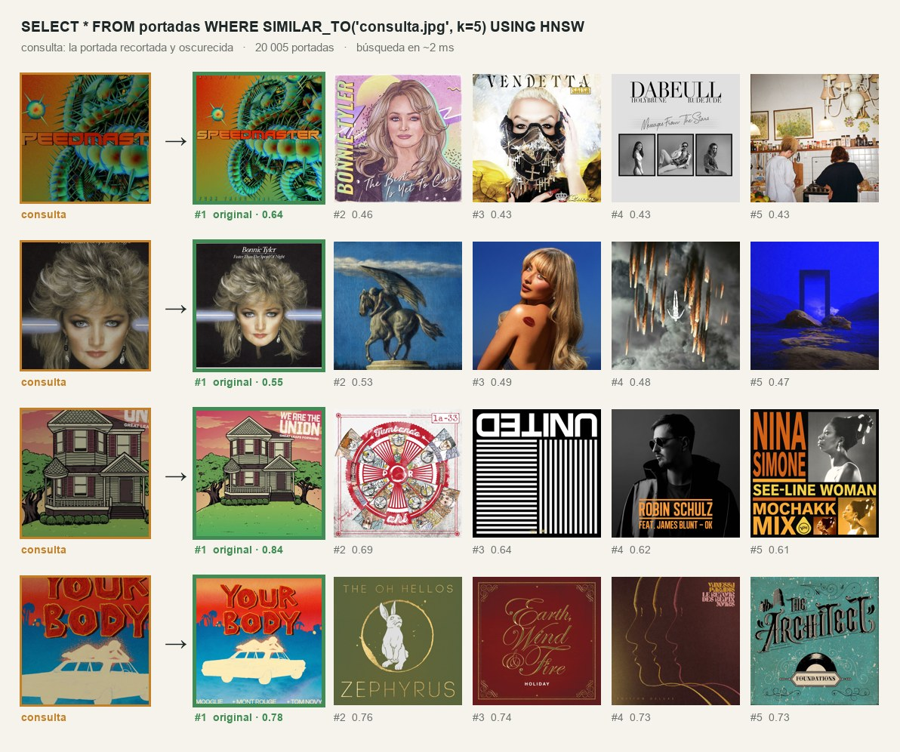
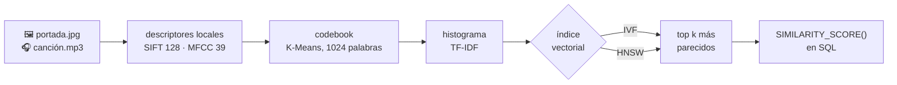
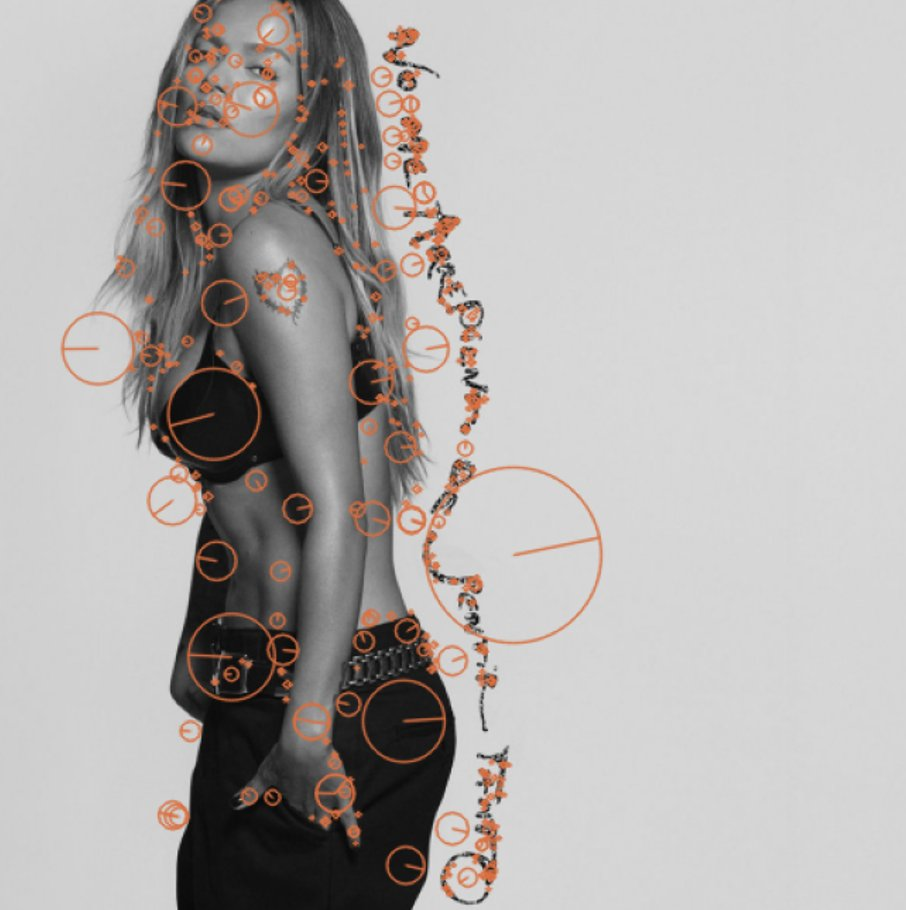
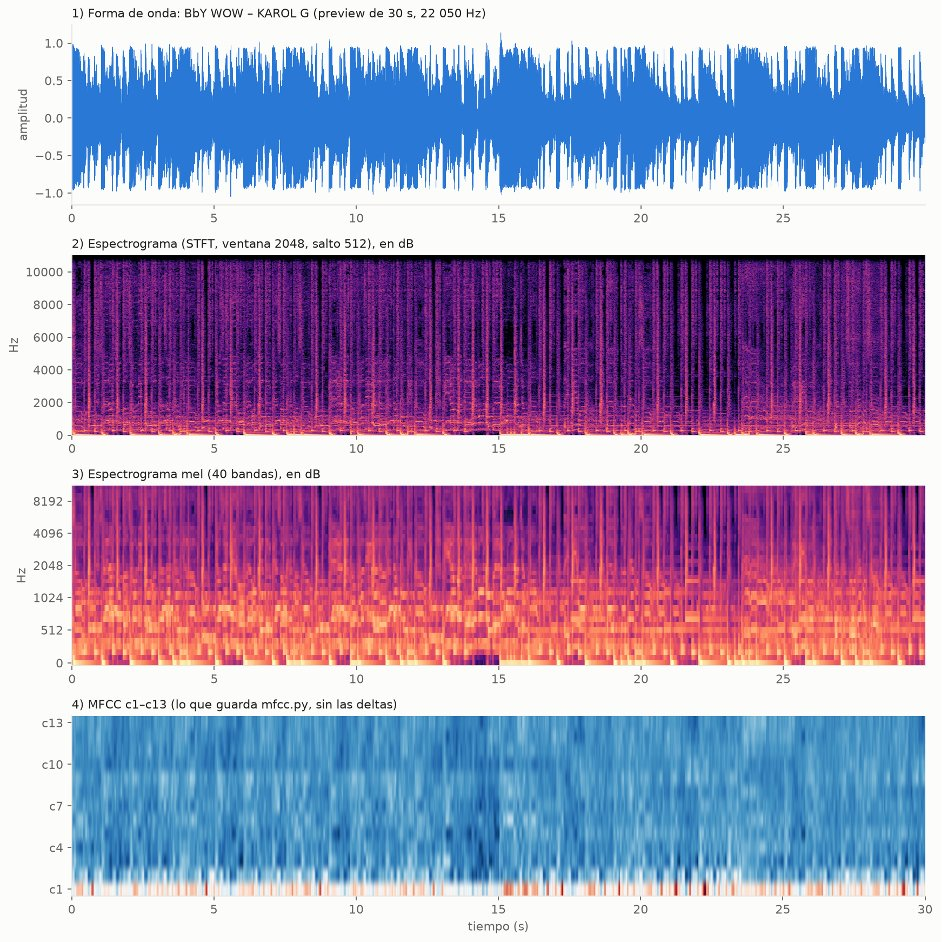
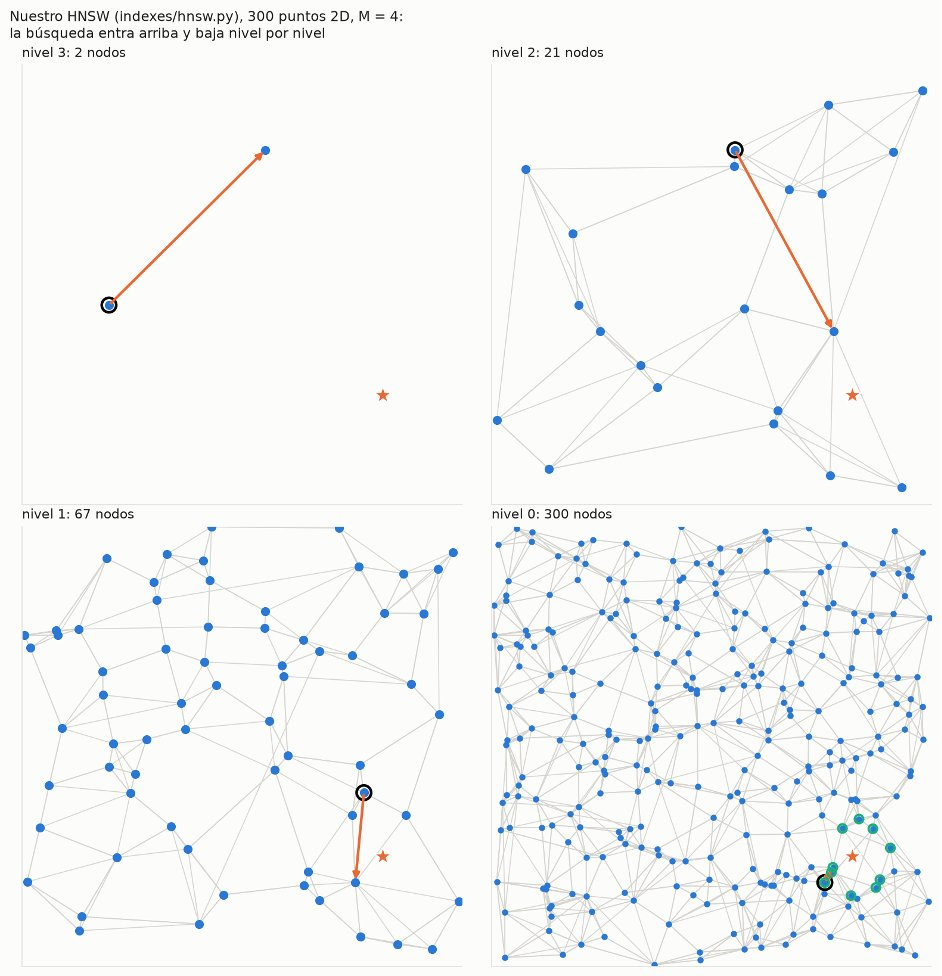
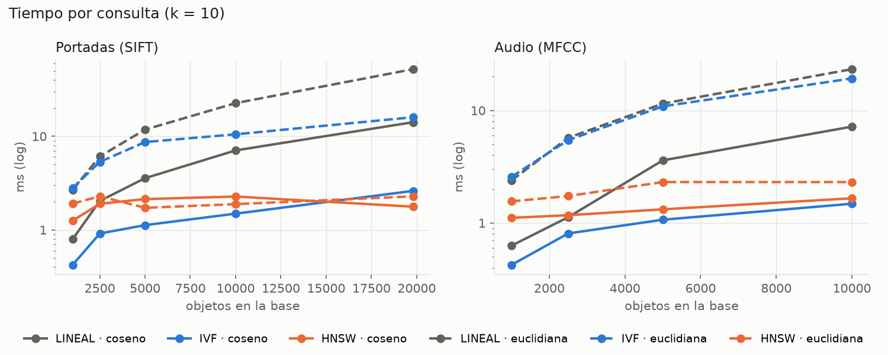
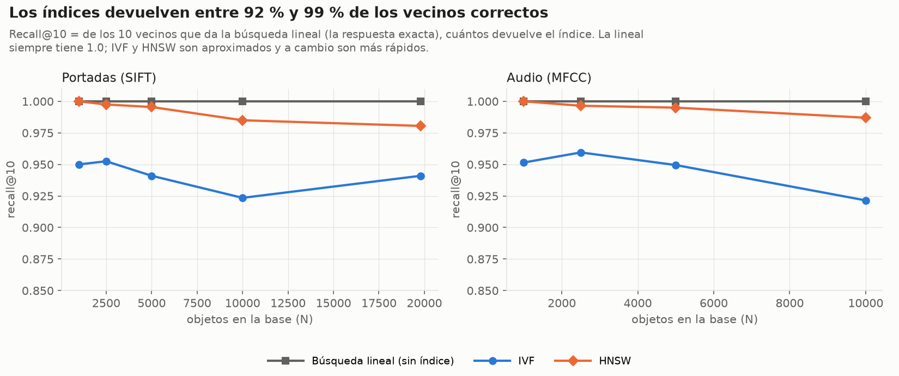

<h1 align="center">chutaDB</h1>

<p align="center">
  <b>Como un Spotify, un Shazam y Google Lens, pero todo a la vez shalom</b><br>
  Una base de datos multimodal hecha desde cero en Python: tablas, mapas, letras de canciones,
  portadas y audio, todo consultable con SQL.
</p>

<p align="center">
  
</p>

<p align="center"><i>
  Le das una portada recortada y oscurecida y chutaDB encuentra la original entre 20 005 portadas en
  ~2 ms, con un índice HNSW que implementamos nosotros.
</i></p>

---

## Qué puede hacer

| | Tipo de dato | Ejemplo | Por dentro |
|---|---|---|---|
| 🗂️ | **Relacional** | `SELECT artista, COUNT(*) FROM canciones GROUP BY artista` | heap y sequential file, B+, hash extensible, bitmap, joins y sort externos |
| 🗺️ | **Espacial** | `SELECT * FROM tiendas ORDER BY distancia(ubicacion, POINT(-77.03, -12.04)) LIMIT 5` | R-Tree con k-NN, rango y polígonos |
| 📝 | **Texto** | buscar canciones por lo que dice su letra (integrándose al SQL) | índice invertido SPIMI con TF-IDF y BM25 |
| 🖼️ | **Imágenes** | `WHERE SIMILAR_TO('portada.jpg', k=10) USING HNSW` | SIFT + bag of visual words + IVF / HNSW |
| 🎧 | **Audio** | `WHERE SIMILAR_TO('fragmento.mp3', k=5) USING IVF` | MFCC + bag of audio words + IVF / HNSW |

Y debajo de todo eso, un motor de verdad: páginas de 4 KB, buffer pool con clock-sweep, catálogo en
disco, transacciones con WAL, undo/redo, locks y `EXPLAIN ANALYZE` al estilo PostgreSQL.

## Lo que hay detrás

<table>
<tr>
<td align="center"><h3>13 643</h3>canciones con audio</td>
<td align="center"><h3>10 031</h3>letras</td>
<td align="center"><h3>20 005</h3>portadas</td>
<td align="center"><h3>22 M</h3>descriptores SIFT y MFCC</td>
</tr>
<tr>
<td align="center"><h3>1.5 ms</h3>por consulta con HNSW<br>(9.5 veces menos que revisar todo)</td>
<td align="center"><h3>0.98</h3>recall@10 con HNSW</td>
<td align="center"><h3>8</h3>índices hechos a mano</td>
<td align="center"><h3>0</h3>bases de datos por debajo</td>
</tr>
</table>

Nada de PostgreSQL ni Faiss por debajo: el parser, el almacenamiento, los índices (B+ agrupado y no
agrupado, hash extensible, bitmap, R-Tree, SPIMI, IVF y HNSW) y los algoritmos externos están escritos
por nosotros. Faiss y hnswlib solo aparecen en el benchmark, para compararnos: **nuestro HNSW iguala
su recall**.

## Cómo funciona una búsqueda por imagen o audio



Es la misma idea que buscar texto, pero las "palabras" se fabrican: cada imagen o audio se parte en
cientos de pedacitos, se agrupan los de toda la colección con K-Means y cada grupo pasa a ser una
palabra. Después cada objeto es un histograma de palabras, como un documento.

<p align="center">
  
  
  
</p>
<p align="center"><sub>Puntos SIFT en una portada · de la onda al espectrograma y a los MFCC · la búsqueda bajando por los niveles del HNSW</sub></p>

## Resultados

Comparamos la búsqueda lineal (revisar toda la base) contra IVF y HNSW, de 1 000 a 19 800 portadas y
10 000 audios:

<p align="center">
  
</p>

| Coseno, k = 10 | Construir (20k portadas) | Consulta | Recall@10 portadas | Recall@10 audio |
|---|---|---|---|---|
| Búsqueda lineal | — | 14.4 ms | 1.000 | 1.000 |
| **IVF** | 11 s | 2.6 ms | 0.941 | 0.922 |
| **HNSW** | 174 s | **1.5 ms** | **0.981** | **0.987** |

<p align="center">
  
</p>
<p align="center"><sub>Recall@10: de los 10 vecinos exactos (búsqueda lineal), cuántos devuelve cada índice</sub></p>

- **Con índice, cada consulta es 4–10 veces más rápida que la búsqueda lineal**, y la ventaja crece
  con N: con el doble de portadas HNSW sigue en ~1.5 ms mientras la lineal se duplica. Con menos de
  ~2 500 objetos la lineal todavía gana
- **IVF se construye 17 veces más rápido**, ideal si la colección cambia seguido
- **Coseno le gana a la euclidiana** sobre vectores sin normalizar: con euclidiana el recall cae a 0.80

También probamos consultas como las de una app real. Con fotos reales de **600 CDs, vinilos y casetes**
bajadas de Discogs, el 66 % encuentra su portada digital en el top 10 (~70 % en CDs y vinilos, casi siempre
primera). Con data augmentation, rotar, pasar a blanco y negro o cambiar los colores casi no afecta
(0.99–1.00), porque SIFT trabaja en gris y es invariante a la rotación. Un fragmento de audio grabado con
celular, en cambio, no acierta nunca, porque MFCC no aguanta que se pierdan frecuencias.

El análisis completo, con galerías de aciertos y errores y la comparación con Faiss y hnswlib, está en
[`benchmark/multimedia/`](benchmark/multimedia/README.md).

## Pruébalo

```bash
conda create -n vision python=3.12 && conda activate vision
pip install -r requirements.txt -r web/backend/requirements.txt
cd web && npm install && cd ..
./run_web.sh                      # API en :8000, consola web en :3000
```

```sql
CREATE TABLE canciones (id INT PRIMARY KEY, titulo VARCHAR(80), artista VARCHAR(60),
                        audio VARCHAR(40), portada VARCHAR(40)) USING HEAP;
INSERT INTO canciones VALUES (1, 'MATADORA', 'KAROL G', 'audio/4176013632.mp3', 'covers/1037643992.jpg');
CREATE INDEX ON canciones (portada) USING HNSW;

SELECT titulo, artista, SIMILARITY_SCORE() AS score FROM canciones
    WHERE SIMILAR_TO('covers/1037643992.jpg', k=10)
    USING HNSW WITH METRIC=cosine
    ORDER BY score DESC;
```

El dataset no está en el repo: se descarga con los scripts de [`scripts/`](data/README.md).
Pruebas: `python run_all_tests.py`.

---

## Documentación

| Tema | Dónde |
|---|---|
| Motor: parser, almacenamiento, B+, hash, bitmap, R-Tree, transacciones (Partes 1 y 2) | [`README-chuta.md`](README-chuta.md) |
| Texto: SPIMI, TF-IDF, BM25 (Parte 3) | [`docs/SPIMI.md`](docs/SPIMI.md) |
| Multimedia: SIFT, MFCC, codebook, TF-IDF (Parte 4) | [`multimedia/README.md`](multimedia/README.md) |
| Índices vectoriales: métricas, IVF, HNSW | [`indexes/VECTOR_README.md`](indexes/VECTOR_README.md) |
| Benchmark multimedia | [`benchmark/multimedia/README.md`](benchmark/multimedia/README.md) |
| Dataset: fuentes, cómo se descarga, columnas | [`data/README.md`](data/README.md) |

### Organización del código

| Carpeta | Qué hay |
|---|---|
| `parser/` | scanner, parser (AST), executor y `EXPLAIN` |
| `storage/` | páginas, buffer pool, heap / sequential file, catálogo, WAL, `vector_index.py` |
| `indexes/` | B+, hash extensible, bitmap, R-Tree, IVF, HNSW y métricas |
| `text_based/` | SPIMI, TF-IDF y BM25 |
| `multimedia/` | SIFT, MFCC, codebook y `ExtractFeatures` |
| `benchmark/` | comparaciones de cada parte |
| `scripts/` | descarga del dataset |
| `web/` | backend FastAPI (`web/backend/`) y frontend Next.js (`web/app/`) |
| `tests/` | pruebas |

### Dataset

| Dato | Fuente | Cantidad |
|---|---|---|
| Audio (preview de 30 s), portada, foto del artista | Deezer API | 13 643 canciones |
| Letra (texto y `.lrc` sincronizado) | LRCLIB | 10 031 con letra |
| Portadas de otros álbumes de los mismos artistas | Deezer API | 20 005 portadas distintas |
| Fotos extra de artistas | TheAudioDB, Wikidata + Wikimedia Commons | |
| Persona o banda, integrantes y puesto | MusicBrainz (+ Wikidata) | |

### SQL de la Parte 4

```
Tipo       ::= ... | IMAGE | AUDIO
Import     ::= IMPORT INTO id FROM ( 'archivo.csv' | 'carpeta/' )
SimilarTo  ::= SIMILAR_TO ( 'ruta' , [k =] num )
UsingVec   ::= USING (IVF | HNSW | SEQ) [WITH METRIC = (cosine | euclidean | dot)]
Proj       ::= ... | SIMILARITY_SCORE ( ) [AS id]
CreateIdx  ::= CREATE INDEX ON id ( columna ) USING (IVF | HNSW)
```

**Con cualquier dataset: columnas `IMAGE` y `AUDIO`.** El motor no depende de nuestras canciones.
Una columna `IMAGE` o `AUDIO` guarda la ruta del archivo, y el tipo le dice al motor si sacar SIFT o MFCC.
Al crear el índice, **cada columna entrena su propio codebook e idf** con los archivos de esa tabla
(`storage/modelo_multimedia.py`, K = raíz del total de descriptores, entre 8 y 1024). El modelo se guarda
junto al índice (`<índice>_modelo.npz`) y los `INSERT` siguientes se vectorizan con él.

```sql
CREATE TABLE fotos (id INT PRIMARY KEY, nombre VARCHAR(60), foto IMAGE) USING HEAP;
IMPORT INTO fotos FROM 'mis_fotos/';          -- una fila por imagen: id 1, 2, 3…, nombre = archivo
CREATE INDEX ON fotos (foto) USING HNSW;      -- entrena el codebook con estas fotos

SELECT nombre, SIMILARITY_SCORE() AS score FROM fotos
    WHERE SIMILAR_TO('consulta.jpg', k=5) ORDER BY score DESC;
```

- **Carga:** `IMPORT INTO t FROM 'carpeta/'` mete una fila por imagen o audio. La primera columna `INT`
  se numera y la primera `VARCHAR` recibe el nombre del archivo. Con un CSV, las rutas de las columnas
  `IMAGE`/`AUDIO` pueden ser relativas al CSV o a `data/`. En la consola web también se puede subir un
  `.zip` (solo imágenes, solo audios, o un CSV con sus archivos): se arma la tabla, se importa y se crea
  un índice HNSW por cada columna multimedia
- `IMAGE` y `AUDIO` no son palabras reservadas: una columna se puede seguir llamando `audio`
- Las tablas con columnas multimedia siguen siendo tablas normales: `JOIN`, `GROUP BY`, índices B+,
  `UPDATE` y `DELETE` funcionan igual (el parser no acepta alias de tabla: usar el nombre completo)
- Sin índice, `SIMILAR_TO` sobre una columna `IMAGE`/`AUDIO` entrena el modelo en el momento y hace
  búsqueda lineal (el modelo queda en memoria mientras la tabla no cambie)
- Una columna `VARCHAR` con rutas sigue funcionando como antes, con el codebook de nuestro dataset
  (`data/features/`)

**Benchmark por SQL con tu propia carpeta**, de punta a punta por el motor: `CREATE TABLE`, `IMPORT`,
`CREATE INDEX` y `SIMILAR_TO` con y sin índice:

```bash
python -m benchmark.multimedia.benchmark_sql --carpeta mis_fotos/ --tamanos 100 250 500 1000
```

Los resultados quedan en `benchmark/multimedia/sql/` (ver
[benchmark por SQL](benchmark/multimedia/README.md#benchmark-por-sql-con-cualquier-carpeta)).

**Detalles de `SIMILAR_TO`:**

- La ruta de la consulta puede ser absoluta o relativa a `data/` y no tiene que estar en la tabla:
  se le saca el vector con el mismo modelo de la columna. La extensión dice si es imagen o audio
- La columna puede ser `IMAGE`, `AUDIO` o un `VARCHAR` con rutas de imágenes o de audios (no mezcladas)
- Sin `USING` se usa el índice vectorial que tenga la tabla (HNSW si tiene los dos, si no IVF), y si
  no tiene, búsqueda lineal. `USING SEQ` (o `LINEAL`) fuerza la búsqueda lineal exacta aunque haya
  índice. Sin `WITH METRIC` se usa coseno
- `SIMILARITY_SCORE()`: mayor = más parecido. Coseno y dot dan la similitud, euclidean da 1 / (1 + d)
- Se combina con otras condiciones con `AND` y con `LIMIT`. No va dentro de un `OR`, con `JOIN` ni
  con agregaciones

```
EXPLAIN ANALYZE SELECT titulo, SIMILARITY_SCORE() AS score FROM canciones
    WHERE SIMILAR_TO('covers/110599312.jpg', k=5) USING HNSW WITH METRIC=cosine;

Index Scan using hnsw_canciones_portada on canciones  (cost=0.29..20.94 rows=5 width=224) (actual time=50.835..50.966 rows=5 loops=1)
  Order By: k-NN por similitud (k=5, metrica=coseno)
  Vectores revisados: 259
  Index Cond: (similar_to('covers/110599312.jpg', k=5))
Planning Time: 0.008 ms
Execution Time: 50.985 ms
```

Para preparar los vectores desde cero (con `data/` descargado):

```bash
python -m multimedia.sift --source covers               # descriptores de portadas
python -m multimedia.mfcc                               # descriptores de audio
python -m multimedia.codebook --tipo ambos --ks 1024    # codebook
python -m multimedia.features --tipo ambos --k 1024     # vectores TF-IDF de la colección
```

### Ideas para la Parte 5

1. **Shazam:** reconocer la canción grabando unos segundos aunque haya ruido, con *audio fingerprinting* (picos del espectrograma como huella de la grabación, como hace Shazam). Se puede hacer con `librosa` o ver `audfprint` / `dejavu`
2. **Detector cantando:** que alguien cante o tararee y diga qué canción es o cuál se parece más, con *query by humming*. Se saca la melodía con `librosa.pyin` y se compara con DTW (`librosa.sequence.dtw`), porque MFCC ignora la melodía a propósito

### Referencias

**Parte 4**
- Lowe, D. G. (2004). Distinctive image features from scale-invariant keypoints. *International Journal of Computer Vision*, 60(2), 91–110.
- Arandjelović, R. y Zisserman, A. (2012). Three things everyone should know to improve object retrieval. *CVPR 2012*, 2911–2918.
- Sivic, J. y Zisserman, A. (2003). Video Google: a text retrieval approach to object matching in videos. *ICCV 2003*, 1470–1477.
- Davis, S. y Mermelstein, P. (1980). Comparison of parametric representations for monosyllabic word recognition in continuously spoken sentences. *IEEE Transactions on Acoustics, Speech, and Signal Processing*, 28(4), 357–366.
- Jégou, H., Douze, M. y Schmid, C. (2011). Product quantization for nearest neighbor search. *IEEE TPAMI*, 33(1), 117–128.
- Malkov, Y. A. y Yashunin, D. A. (2020). Efficient and robust approximate nearest neighbor search using Hierarchical Navigable Small World graphs. *IEEE TPAMI*, 42(4), 824–836.

La lista completa está al final de [`multimedia/README.md`](multimedia/README.md#referencias),
[`indexes/VECTOR_README.md`](indexes/VECTOR_README.md#referencias) y
[`benchmark/multimedia/README.md`](benchmark/multimedia/README.md#referencias).

**Datos:** [Deezer API](https://developers.deezer.com/api), [LRCLIB](https://lrclib.net),
[MusicBrainz](https://musicbrainz.org), [TheAudioDB](https://www.theaudiodb.com),
[Wikidata](https://www.wikidata.org) y [Wikimedia Commons](https://commons.wikimedia.org). Los previews
y las portadas tienen copyright: el dataset es solo para uso académico y no se redistribuye.

## Equipo

Grupo 3 · Base de Datos II · UTEC · Prof. Heider Sanchez

Rodrigo De la Puente · Jimena Gurbillón · Yaritza López · Carlos Ordinola · Matías Walde
