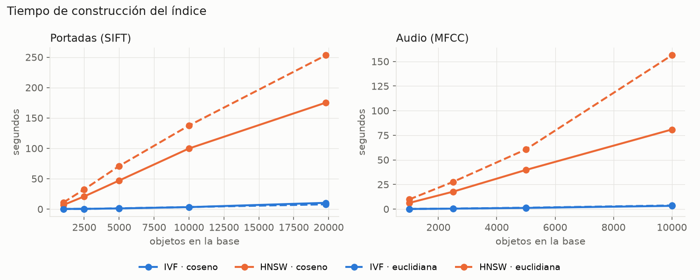
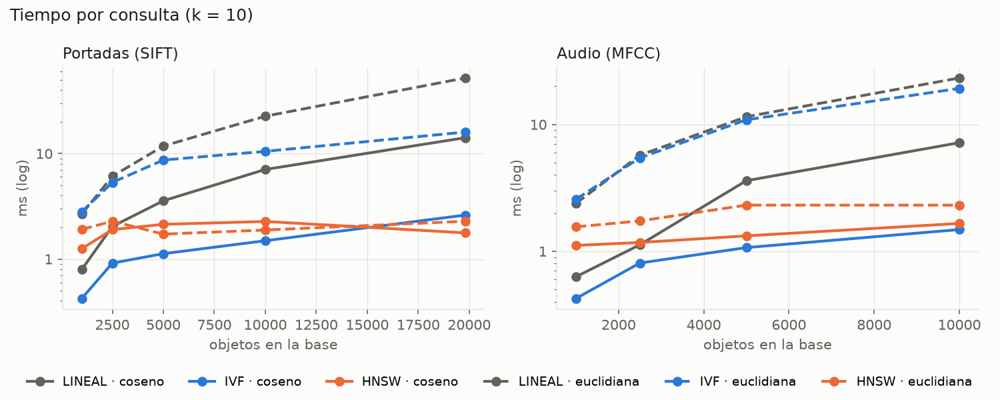
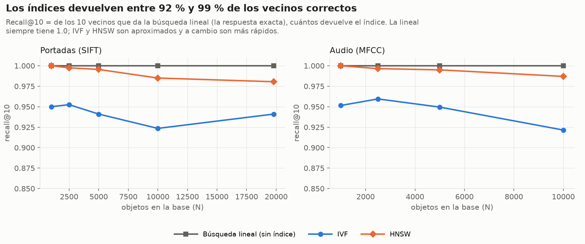
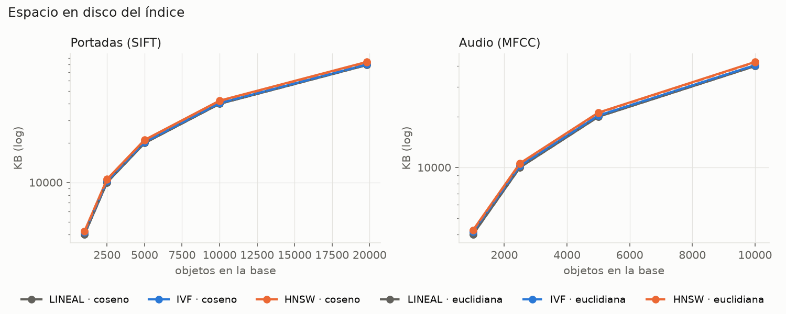
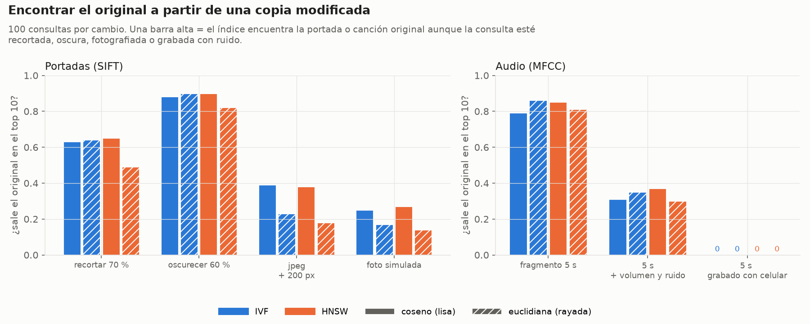
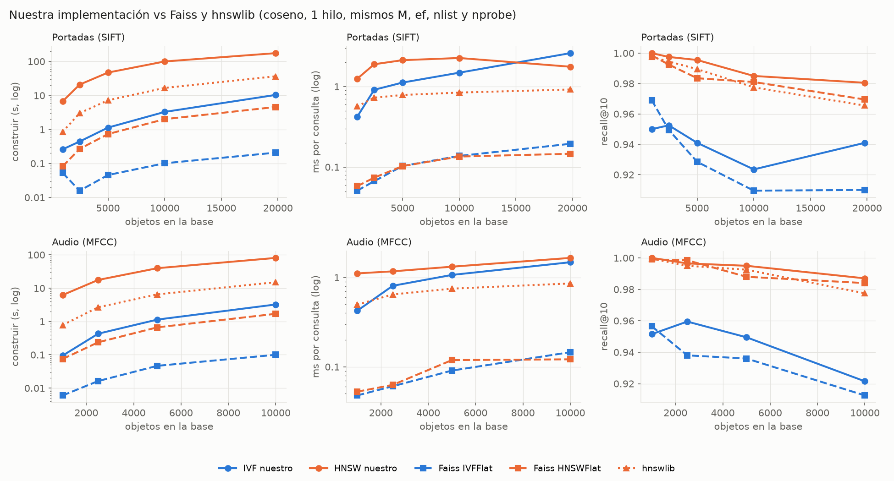
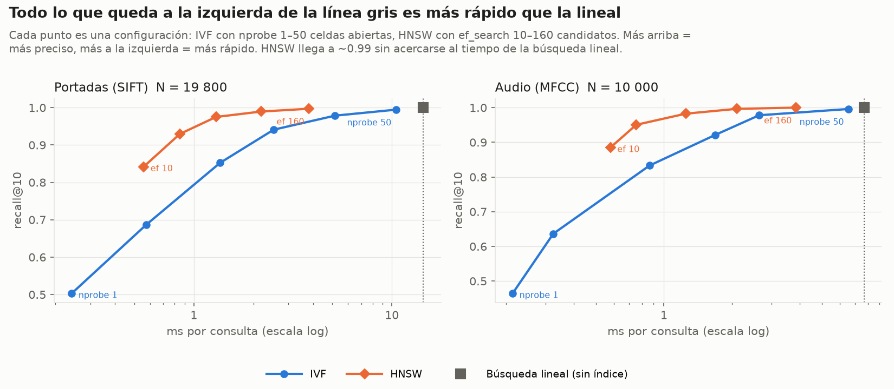
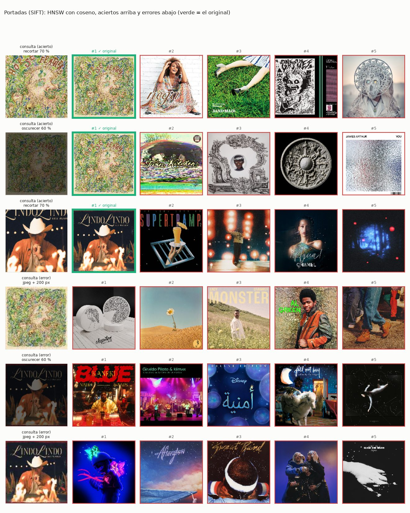
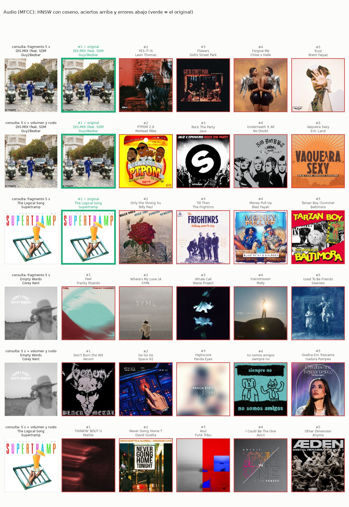

# Benchmark de la Parte 4: IVF vs HNSW, euclidiana vs coseno

Compara los dos índices vectoriales (`indexes/ivf.py`, `indexes/hnsw.py`) y las dos métricas
sobre los vectores TF-IDF de las portadas (SIFT) y del audio (MFCC), con consultas k-NN de k = 10.

```bash
python -m benchmark.multimedia.benchmark_vectorial                      # con data/ completa (10k)
python -m benchmark.multimedia.benchmark_vectorial --data data/sim_1k   # con 1k, ~2 min
python -m benchmark.multimedia.benchmark_vectorial --solo-graficas      # rehace las imágenes
```

Sin `--tamanos` elige solo según la data que haya: con 10k corre 1 000, 2 500, 5 000 y 10 000
objetos; con 1k corre 250, 500 y 750. Las imágenes y `resultados.json` van a `graficas/`
(o a `--salida`), junto con `resultados.json`.

## Cómo se mide

- **Base:** los primeros N objetos de `sift_covers.csv` y `mfcc.csv`, con el codebook K = 1024.
  El idf se calcula con esos N, como lo haría la base de datos real.
- **Consultas:** 200 objetos que no están en ninguna base (100 con 1k).
- **Recall@10:** cuántos de los 10 vecinos exactos (búsqueda lineal con la misma métrica)
  devuelve el índice.
- **Vectores sin normalizar:** si se normalizan, euclidiana y coseno ordenan igual
  (‖a − b‖² = 2 − 2·cos), así que para compararlas se usa el TF-IDF tal cual.
- **Parámetros:** IVF con nlist = √N y nprobe = 10; HNSW con M = 16, ef_construction = 100 y
  ef_search = 50. Faiss (`IndexIVFFlat`, `IndexHNSWFlat`) y hnswlib usan los mismos, con 1 hilo.
  Necesitan `pip install faiss-cpu hnswlib`.
- **Espacio:** lo que ocupa el índice guardado en disco (vectores + celdas o grafo).
- **Original de una consulta modificada:** 100 portadas recortadas al 70 %, oscurecidas al 60 % o
  bajadas a 200 px en jpeg, y 100 canciones cortadas a 5 s (con y sin ruido). Se mira si el
  original sale entre los 10 primeros. Sale de ahí la galería.

## Resultados con 10 000 objetos

La corrida completa (4 tamaños, 2 métricas, imágenes y audio, con las librerías) tarda
**17 min 22 s** en un MacBook; lo que más pesa es construir nuestro HNSW en Python.

| tipo | índice | métrica | construir (s) | consulta (ms) | recall@10 |
|---|---|---|---|---|---|
| portadas | lineal | coseno | — | 9.8 | 1.000 |
| portadas | IVF | coseno | 3.7 | 1.6 | 0.903 |
| portadas | HNSW | coseno | 92 | 1.5 | 0.980 |
| portadas | lineal | euclidiana | — | 24.2 | 1.000 |
| portadas | IVF | euclidiana | 4.2 | 10.7 | 0.966 |
| portadas | HNSW | euclidiana | 116 | 2.0 | 0.961 |
| audio | lineal | coseno | — | 10.1 | 1.000 |
| audio | IVF | coseno | 3.5 | 1.7 | 0.922 |
| audio | HNSW | coseno | 82 | 1.7 | 0.987 |
| audio | lineal | euclidiana | — | 23.2 | 1.000 |
| audio | IVF | euclidiana | 3.3 | 20.0 | 0.998 |
| audio | HNSW | euclidiana | 144 | 2.0 | 0.983 |





El espacio es casi igual en todos (~40 MB): lo que pesa son los vectores (10 000 × 1 024 floats).
Las celdas del IVF suman ~0.5 MB y el grafo del HNSW ~2 MB.



¿Sale el original en el top 10?

| consulta | IVF coseno | IVF euclidiana | HNSW coseno | HNSW euclidiana |
|---|---|---|---|---|
| portada recortada 70 % | .69 | .73 | .78 | .63 |
| portada oscurecida 60 % | .84 | .88 | .88 | .79 |
| portada jpeg + 200 px | .44 | .32 | .45 | .23 |
| audio fragmento 5 s | .79 | .86 | .85 | .81 |
| audio 5 s + ruido | .34 | .36 | .38 | .31 |



### Contra Faiss y hnswlib (coseno, 10 000 objetos)

Las mismas estructuras en C++, con los mismos parámetros y 1 hilo (`nuestro_vs_librerias.png`):

| | construir (s) | consulta (ms) | recall@10 portadas | recall@10 audio |
|---|---|---|---|---|
| IVF nuestro | 3.6 | 1.6 | 0.903 | 0.922 |
| Faiss IVFFlat | 0.1 | 0.14 | 0.915 | 0.912 |
| HNSW nuestro | 82–92 | 1.5–1.7 | 0.980 | 0.987 |
| Faiss HNSWFlat | 1.7–2.0 | 0.12 | 0.981 | 0.984 |
| hnswlib | 15–17 | 0.87 | 0.978 | 0.978 |



El recall es el mismo: el algoritmo está bien implementado. La diferencia de tiempo es de
lenguaje (Python vs C++ con SIMD): ~45 veces al construir el HNSW y ~12 veces al consultar.

## Qué se ve

- **HNSW es el más rápido al consultar** (~1.5–2 ms contra 10–24 ms de la búsqueda lineal) y casi no
  crece con N: ~1.1–1.5 ms con 1k y ~1.5–2 ms con 10k. Lo caro es construirlo: ~90 s para 10k en
  Python puro, contra ~3.5 s del IVF.
- **IVF construye ~25 veces más rápido** pero con nprobe = 10 pierde más recall (0.90–0.92 con
  coseno). Subiendo nprobe a 20 llega a 0.96–0.98 y sigue siendo 3–5 veces más rápido que lo lineal
  (`recall_vs_tiempo.png`).

  
- **La euclidiana sobre vectores sin normalizar arruina el IVF.** Las normas van de 0 a 2.2
  (mediana 0.1), así que K-Means agrupa por tamaño del vector y no por contenido: las 10 celdas
  más grandes tienen el 66 % de la base (con coseno ninguna pasa de 205 vectores). Con nprobe = 10
  termina revisando casi todo: recall alto pero casi tan lento como la búsqueda lineal.
- **También afecta a los grafos de las librerías:** con euclidiana, Faiss HNSW baja a 0.84–0.91 de
  recall y hnswlib a 0.86–0.92 (nuestro HNSW se mantiene en 0.96–0.98 gracias a la heurística de
  selección de vecinos, aunque es mucho más lento).
- **Coseno encuentra mejor el original con HNSW** (portada recortada .78 vs .63, jpeg .45 vs .23):
  el tamaño del vector depende de cuántas palabras raras tiene la imagen, no de qué muestra, y
  coseno lo ignora.
- Las consultas difíciles (jpeg chico, audio con ruido) fallan igual en los cuatro: el límite ahí
  es el descriptor y el codebook, no el índice.

## Galería: aciertos y errores

Consulta modificada a la izquierda y los 5 primeros resultados; borde verde = el original.
Arriba los aciertos, abajo los errores. Están las 8 combinaciones en `graficas/galeria_*.jpg`.




## Recomendación

| Si… | Usar |
|---|---|
| se consulta mucho y la base cambia poco | **HNSW + coseno** (o vectores normalizados) |
| se reconstruye seguido o se carga mucha data nueva | **IVF + coseno**, con nprobe ≈ 20 % de nlist |
| la base es chica (< 1 000) | búsqueda lineal: ya tarda menos de 1 ms |
| se quiere euclidiana | normalizar antes; si no, el IVF degenera |
| hace falta velocidad real en producción | Faiss o hnswlib: mismo recall, 10–45 veces más rápido |

Por eso el motor (`storage/vector_index.py`) guarda los vectores normalizados: así un solo índice
sirve para las tres métricas del `WITH METRIC`.

## Imágenes en `graficas/`

| archivo | qué muestra |
|---|---|
| `construccion_vs_n.png` | tiempo de construcción vs tamaño |
| `consulta_vs_n.png` | tiempo por consulta vs tamaño, con la búsqueda lineal |
| `recall_vs_n.png` | recall@10 contra la búsqueda exacta |
| `espacio_vs_n.png` | espacio en disco |
| `recall_vs_tiempo.png` | curvas nprobe 1–50 y ef_search 10–160 con 10k |
| `nuestro_vs_librerias.png` | nuestro IVF y HNSW contra Faiss y hnswlib |
| `calidad_original.png` | si sale el original de una consulta modificada |
| `galeria_<tipo>_<índice>_<métrica>.jpg` | aciertos y errores con las portadas (verde = el original) |
| `tabla.md` | la tabla de arriba, con las librerías |
| `resultados.json` | todos los números |

El enunciado pide también 100 000 objetos. El dataset tiene 10 000 canciones y 20 005 portadas
(`covers.csv`); esta corrida llega a 10k en los dos.
