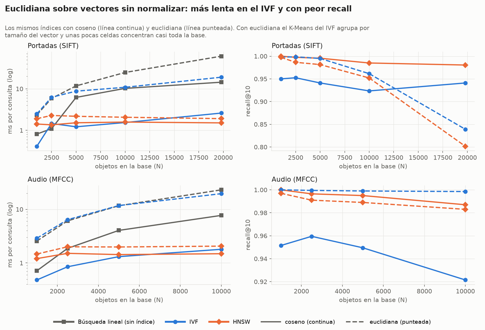
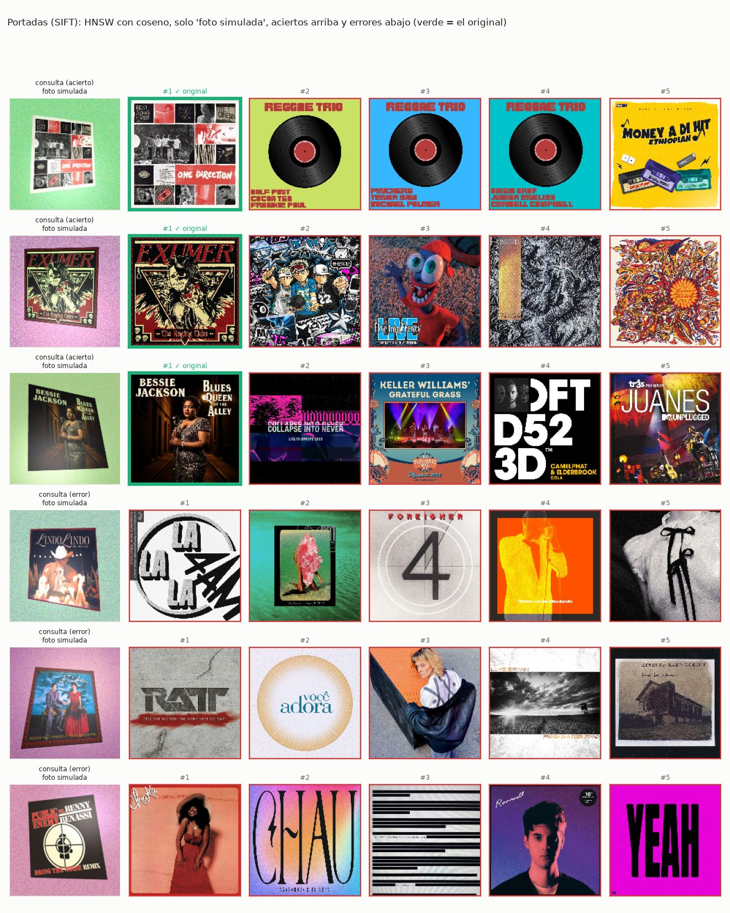

# Benchmark de la Parte 4: búsqueda lineal vs IVF vs HNSW

¿Vale la pena tener un índice vectorial o basta con revisar toda la base? Este benchmark compara la
**búsqueda lineal** (comparar la consulta con todos los objetos, la respuesta exacta) con nuestros dos
índices, **IVF** (`indexes/ivf.py`) y **HNSW** (`indexes/hnsw.py`), sobre los vectores TF-IDF de las
portadas (SIFT) y del audio (MFCC), con consultas k-NN de k = 10.

```bash
python -m benchmark.multimedia.benchmark_vectorial                      # con data/ completa
python -m benchmark.multimedia.benchmark_vectorial --data data/sim_1k   # con 1k, ~2 min
python -m benchmark.multimedia.benchmark_vectorial --solo-graficas      # rehace las imágenes desde resultados.json
```

Sin `--tamanos` cada tipo elige según la data que tenga: portadas 1 000, 2 500, 5 000, 10 000 y
19 800; audio hasta 10 000; con `data/sim_1k` corre 250, 500 y 750. Las imágenes y `resultados.json`
van a `graficas/` (o a `--salida`).

## En resumen

| Coseno, k = 10 | Construir | Consulta | Más rápido que la lineal | Recall@10 |
|---|---|---|---|---|
| **Portadas, N = 19 800** | | | | |
| Búsqueda lineal | — | 14.4 ms | — | 1.000 |
| IVF | 11 s | 2.6 ms | 5.5× | 0.941 |
| HNSW | 174 s | **1.5 ms** | **9.5×** | **0.981** |
| **Audio, N = 10 000** | | | | |
| Búsqueda lineal | — | 7.7 ms | — | 1.000 |
| IVF | 3.9 s | 1.8 ms | 4.3× | 0.922 |
| HNSW | 83 s | **1.5 ms** | **5.2×** | **0.987** |

- **Con índice, cada consulta es 4–10 veces más rápida** que la búsqueda lineal, y la diferencia crece
  con N: la lineal crece en proporción a N, los índices mucho menos
- **HNSW es el más rápido y el más preciso** (recall 0.98–0.99), pero tarda ~15–20 veces más en
  construirse que IVF
- **Con menos de ~2 500 objetos conviene la búsqueda lineal:** ya tarda menos de 2 ms y no hay que
  construir nada
- **Coseno es mejor que euclidiana** sobre estos vectores (sección [Coseno vs euclidiana](#coseno-vs-euclidiana))

## Cómo se mide

- **Base:** los primeros N objetos de `sift_covers.csv` y `mfcc.csv`, con el codebook K = 1024.
  El idf se calcula con esos N, como lo haría la base de datos real
- **Consultas:** 200 objetos que no están en ninguna base (100 con 1k)
- **Búsqueda lineal:** `knn_exacto` de `indexes/metricas.py`, una multiplicación de matrices contra
  los N vectores. Es la respuesta correcta contra la que se mide el recall
- **Recall@10:** de los 10 vecinos que da la búsqueda lineal, cuántos devuelve el índice
- **Vectores sin normalizar:** si se normalizan, euclidiana y coseno ordenan igual
  (‖a − b‖² = 2 − 2·cos), así que para compararlas se usa el TF-IDF tal cual
- **Parámetros:** IVF con nlist = √N y nprobe = 10; HNSW con M = 16, ef_construction = 100 y
  ef_search = 50. Faiss (`IndexIVFFlat`, `IndexHNSWFlat`) y hnswlib usan los mismos, con 1 hilo.
  Necesitan `pip install faiss-cpu hnswlib`
- **Espacio:** lo que ocupa el índice guardado en disco (vectores + celdas o grafo)
- La corrida completa, con las librerías, tarda **26 min 43 s** en un MacBook. Lo que más pesa es
  construir nuestro HNSW en Python (~3–4 min con 20k)

## Las 4 gráficas principales (coseno)

En todas: gris = búsqueda lineal, azul = IVF, naranja = HNSW.

### 1. Tiempo por consulta


La búsqueda lineal compara con los N objetos, así que su tiempo crece con N: con portadas pasa de
0.8 ms (1k) a 14.4 ms (19 800). IVF solo abre 10 celdas y HNSW visita unos cientos de nodos del grafo,
así que crecen mucho menos. Con pocos objetos la lineal gana: buscar en el índice tiene un costo fijo
(elegir celdas, recorrer el grafo en Python) que con N chico pesa más que revisar todo.

### 2. Recall@10


La lineal siempre tiene 1.0 porque es la respuesta exacta. HNSW se mantiene en 0.98–1.00; IVF en
0.92–0.96, porque a veces el vecino correcto quedó en una celda que no se abrió.

### 3. Velocidad vs precisión


Cada punto es una configuración del índice: IVF con nprobe de 1 a 50 celdas abiertas y HNSW con
ef_search de 10 a 160 candidatos. Más arriba es más preciso y más a la izquierda, más rápido. Todo lo
que queda a la izquierda de la línea gris le gana en tiempo a la búsqueda lineal. HNSW llega a ~0.99
gastando una fracción del tiempo de la lineal; IVF necesita abrir muchas más celdas para llegar a lo
mismo y con nprobe = 50 ya tarda casi como la lineal.

### 4. Tiempo de construcción


Es el precio de los índices. La búsqueda lineal no construye nada. IVF corre K-Means con √N centroides
(11 s con 20k portadas); HNSW inserta los nodos uno por uno buscando sus vecinos en el grafo, en
Python puro (174 s).

## Más detalle

### Coseno vs euclidiana



| N máximo | índice | consulta coseno | consulta euclidiana | recall coseno | recall euclidiana |
|---|---|---|---|---|---|
| portadas 19 800 | lineal | 14.4 ms | 61.1 ms | 1.000 | 1.000 |
| portadas 19 800 | IVF | 2.6 ms | 19.0 ms | 0.941 | 0.839 |
| portadas 19 800 | HNSW | 1.5 ms | 1.9 ms | 0.981 | 0.801 |
| audio 10 000 | lineal | 7.7 ms | 23.1 ms | 1.000 | 1.000 |
| audio 10 000 | IVF | 1.8 ms | 19.6 ms | 0.922 | 0.998 |
| audio 10 000 | HNSW | 1.5 ms | 2.1 ms | 0.987 | 0.983 |

**La euclidiana sobre vectores sin normalizar empeora con N.** Las normas van de 0 a 2.2 (mediana
0.1), así que el vecino "más cercano" depende del tamaño del vector y no de lo que muestra. En el IVF,
K-Means agrupa por tamaño: con 10k las 10 celdas más grandes tienen el 66 % de la base, y con
nprobe = 10 termina revisando casi todo (19 ms, casi como la lineal; por eso su recall en audio es
0.998). Con 20k portadas el recall con euclidiana cae a 0.80–0.84, mientras con coseno se mantiene en
0.94–0.98.

### Espacio


El espacio crece lineal con N y es casi igual en todos: lo que pesa son los vectores
(19 800 × 1 024 floats ≈ 77 MB). Las celdas del IVF suman ~0.7 MB y el grafo del HNSW ~4.4 MB.

### Contra Faiss y hnswlib (coseno)

Las mismas estructuras en C++, con los mismos parámetros y 1 hilo:

| | construir 20k portadas | consulta | recall@10 portadas 20k | recall@10 audio 10k |
|---|---|---|---|---|
| Búsqueda lineal (nuestra) | — | 14.4 ms | 1.000 | 1.000 |
| IVF nuestro | 11 s | 2.6 ms | 0.941 | 0.922 |
| Faiss IVFFlat | 0.3 s | 0.19 ms | 0.910 | 0.912 |
| HNSW nuestro | 174 s | 1.5 ms | 0.981 | 0.987 |
| Faiss HNSWFlat | 6.0 s | 0.19 ms | 0.970 | 0.984 |
| hnswlib | 38.5 s | 0.96 ms | 0.966 | 0.978 |


El recall es el mismo o mejor: el algoritmo está bien implementado. La diferencia de tiempo es de
lenguaje (Python vs C++ con SIMD): ~30 veces al construir el HNSW y ~8 veces al consultar.

### Encontrar el original de una consulta modificada

Se toma un objeto de la base, se modifica y se mira si el original sale entre los 10 primeros
(100 consultas por cambio; portadas con 19 800 y audio con 10 000):

| consulta | IVF coseno | IVF euclidiana | HNSW coseno | HNSW euclidiana |
|---|---|---|---|---|
| portada recortada al 70 % | .63 | .64 | .65 | .49 |
| portada oscurecida al 60 % | .88 | .90 | .90 | .82 |
| portada en jpeg a 200 px | .39 | .23 | .38 | .18 |
| **portada en foto simulada** | .25 | .17 | .27 | .14 |
| audio, fragmento de 5 s | .79 | .86 | .85 | .81 |
| audio, 5 s + volumen y ruido | .31 | .35 | .37 | .30 |
| **audio, 5 s grabado con celular** | 0 | 0 | 0 | 0 |


Las dos consultas nuevas imitan lo que pasaría en una app de verdad:

- **Foto simulada:** como si alguien le tomara una foto al CD o al póster. La portada se pone en
  perspectiva sobre un fondo de color, con tinte de luz cálida o fría, un reflejo, desenfoque, ruido de
  cámara y jpeg (`foto_simulada` en `benchmark_vectorial.py`; cada portada siempre recibe la misma
  foto). Acierta ~1 de cada 4: el fondo y el reflejo agregan descriptores SIFT que no son de la
  portada, y la perspectiva deforma los que sí son
- **Grabado con celular:** el fragmento pasa por un filtro de 300–3 400 Hz (lo que dejan pasar el
  parlante y el micrófono de un celular), con eco de la habitación y ruido. **No acierta nunca.**
  Probamos cada efecto por separado con 25 canciones: el eco solo deja 0.76, pero quitar frecuencias
  la arruina (0.00 con 300–3 400 Hz y 0.04 incluso con 100–7 000 Hz). Los MFCC describen la forma del
  espectro y el filtro la cambia entera, así que todas las ventanas caen en otras palabras del
  codebook. Por eso para reconocer una canción grabada (Shazam) hace falta otra técnica, como huellas
  de picos del espectrograma (ver *Ideas para la Parte 5* en el README principal)

Las consultas difíciles fallan parecido en los cuatro: el límite ahí es el descriptor y el codebook,
no el índice. Coseno encuentra mejor el original porque ignora el tamaño del vector.

### Galería: aciertos y errores

Consulta modificada a la izquierda y los 5 primeros resultados; borde verde = el original.
Arriba los aciertos, abajo los errores. Están las 8 combinaciones en `graficas/galeria_*.jpg`.





## Recomendación

| Si… | Usar |
|---|---|
| la base es chica (< 2 500) | **búsqueda lineal**: tarda menos de 2 ms y no hay que construir nada |
| se consulta mucho y la base cambia poco | **HNSW + coseno** (o vectores normalizados) |
| se reconstruye seguido o se carga mucha data nueva | **IVF + coseno**, con nprobe ≈ 20 % de nlist |
| se quiere euclidiana | normalizar antes; si no, el IVF degenera |
| hace falta velocidad real en producción | Faiss o hnswlib: mismo recall, 8–30 veces más rápido |

Por eso el motor (`storage/vector_index.py`) guarda los vectores normalizados: así un solo índice
sirve para las tres métricas del `WITH METRIC`.

## Imágenes en `graficas/`

| archivo | qué muestra |
|---|---|
| `consulta_vs_n.png` | 1. tiempo por consulta vs N, lineal vs IVF vs HNSW |
| `recall_vs_n.png` | 2. recall@10 contra la búsqueda exacta |
| `recall_vs_tiempo.png` | 3. velocidad vs precisión (nprobe 1–50, ef_search 10–160) |
| `construccion_vs_n.png` | 4. tiempo de construcción |
| `coseno_vs_euclidiana.png` | las dos métricas, con la lineal |
| `espacio_vs_n.png` | espacio en disco |
| `nuestro_vs_librerias.png` | nuestro IVF y HNSW contra Faiss y hnswlib |
| `calidad_original.png` | si sale el original de una consulta modificada |
| `galeria_<tipo>_<índice>_<métrica>.jpg` | aciertos y errores (verde = el original) |
| `galeria_foto_simulada.jpg` | solo las fotos simuladas, con HNSW coseno |
| `tabla.md` | todos los números con el N más grande, con las librerías |
| `resultados.json` | todos los números |

El enunciado pide también 100 000 objetos. El dataset tiene 10 000 canciones y 20 005 portadas
(`covers.csv`), así que llega a 10k en audio y ~20k en imágenes. Si se bajan más portadas con
`scripts/fetch_covers.py --total 100000`, el script sigue solo a 50k y 100k (ver
[`docs/PENDIENTES.md`](../../docs/PENDIENTES.md)).

## Cambios del 9 de noviembre

- Las gráficas se rehicieron para que se entienda la comparación con la búsqueda lineal: 4
  principales solo con coseno, la lineal en todas y en la leyenda, títulos con la conclusión y una
  bajada que explica qué se mide. Euclidiana, espacio y librerías pasaron a *Más detalle*, con
  leyendas que separan qué es el color y qué es el trazo
- Nuevas consultas modificadas: foto simulada de la portada y fragmento grabado con celular, con su
  galería (`galeria_foto_simulada.jpg`)
- Se volvió a correr todo con 19 800 portadas y 10 000 audios

## Referencias

- Johnson, J., Douze, M. y Jégou, H. (2021). Billion-scale similarity search with GPUs. *IEEE Transactions on Big Data*, 7(3), 535–547. (Faiss)
- Malkov, Y. A. y Yashunin, D. A. (2020). Efficient and robust approximate nearest neighbor search using Hierarchical Navigable Small World graphs. *IEEE TPAMI*, 42(4), 824–836. (HNSW y hnswlib: https://github.com/nmslib/hnswlib)
- Jégou, H., Douze, M. y Schmid, C. (2011). Product quantization for nearest neighbor search. *IEEE TPAMI*, 33(1), 117–128. (IVF)
- Wang, A. (2003). An industrial-strength audio search algorithm. *ISMIR 2003*. (huellas de audio de Shazam)
