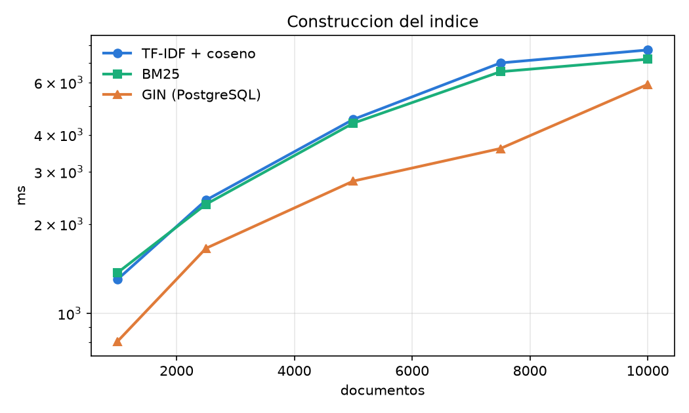
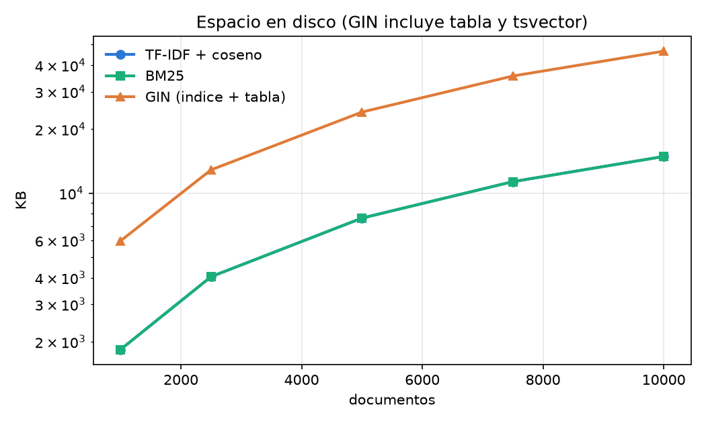
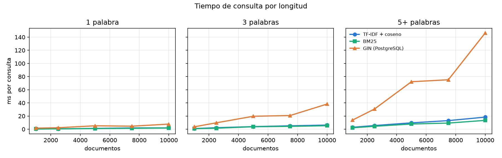
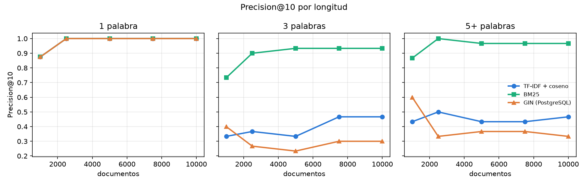
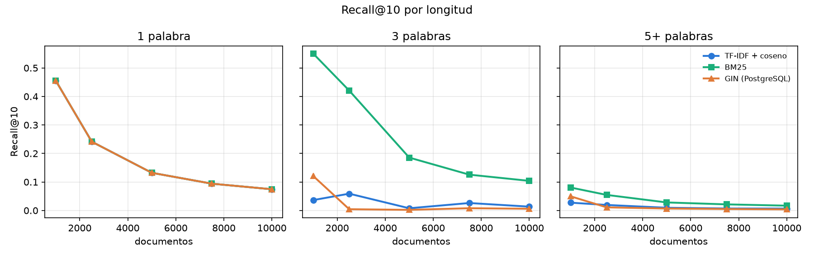
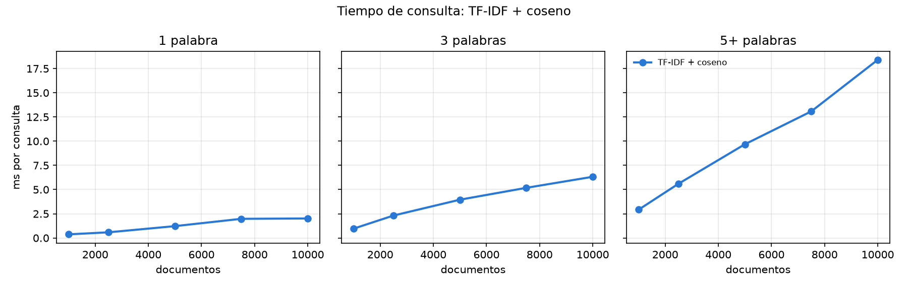
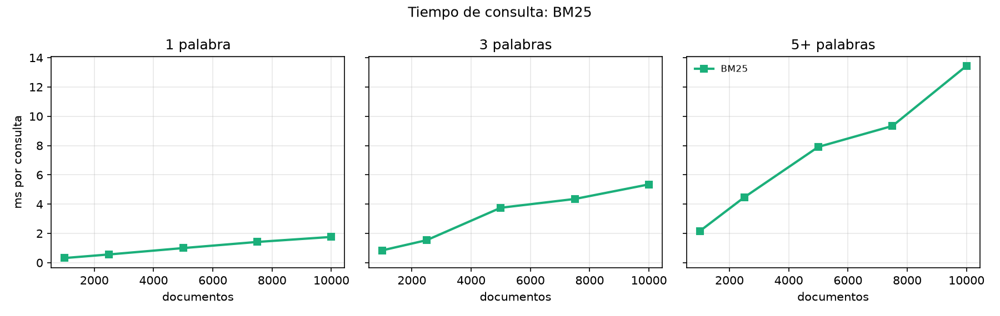
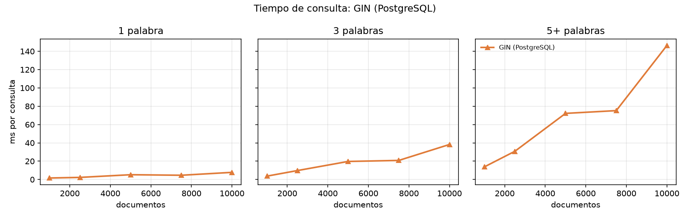

# Benchmark textual: TF-IDF + coseno vs BM25 vs PostgreSQL GIN

Compara tres formas de recuperar letras de canciones con **el mismo corpus,
las mismas consultas y el mismo ground truth**:

- **TF-IDF + coseno** sobre el índice invertido SPIMI propio.
- **BM25** sobre el mismo índice SPIMI.
- **GIN de PostgreSQL 18** como baseline externo, con `tsvector`,
  `to_tsquery` y `ts_rank_cd`.

Para cada tamaño se mide construcción, consulta (media y p95), Precision@10,
Recall@10, espacio en disco y memoria pico del proceso Python.

## Cómo reproducirlo

Desde la raíz del repo:

```bash
python benchmark/text_based_benchmark.py \
  --sizes 1000 2500 5000 7500 10000 \
  --repeats 5 \
  --dsn "postgresql://postgres@127.0.0.1:5432/postgres"
```

El DSN también se puede pasar con `POSTGRES_DSN`. Si no hay PostgreSQL
disponible, el script corre igual TF-IDF y BM25 con `--sin-gin`.

```bash
python benchmark/text_based_benchmark.py --solo-graficas
```

Ese último comando rehace `tabla.md` y las imágenes desde `resultados.json`
sin volver a construir los índices.

Salidas:

- `resultados.json`: todos los tiempos y métricas por consulta.
- `tabla.md`: tabla completa, consulta por consulta.
- `*.png`: las gráficas de esta página.

## Metodología

- **Corpus:** los primeros N registros con texto de `data/lyrics.jsonl`
  (10 002 disponibles). Tamaños: **1 000, 2 500, 5 000, 7 500 y 10 000**.
- **Consultas:** 10 en total, elegidas antes de medir.
  - 1 palabra: `love`, `fire`, `thunder`, `midnight`.
  - 3 palabras: `love heart baby`, `fire water soul`, `rain dream winter`.
  - 5+ palabras: `love heart baby night fire`,
    `love time never without your`, `heart baby night rain dream`.
- **Ground truth:** un documento es relevante si contiene al menos 1 término
  para consultas de 1 palabra, 2 términos para las de 3 palabras y 3 términos
  para las de 5+. Se calcula una sola vez con el índice invertido y se aplica
  igual a las tres técnicas.
- **Precision@10:** aciertos en el top 10 dividido 10. Si una consulta tiene
  menos de 10 documentos relevantes, el máximo posible es menor que 1.
- **Recall@10:** aciertos en el top 10 dividido el total de documentos
  relevantes. Por eso baja con N: el conjunto relevante crece y el top 10 no.
- **Tiempos de consulta:** 5 repeticiones por consulta; se reporta la media.
- **Construcción TF-IDF/BM25:** incluye SPIMI + la pasada de estadísticas de
  cada ranker.
- **Construcción GIN:** carga de filas + `CREATE INDEX`.
- **Memoria:** pico de `tracemalloc` en una construcción separada, para no
  inflar el tiempo medido. La memoria de GIN no se mide desde Python.

## Resultados

### Construcción, espacio y memoria

| N | TF-IDF | BM25 | GIN | SPIMI en disco | GIN índice | GIN tabla | GIN total | Memoria SPIMI |
|---:|---:|---:|---:|---:|---:|---:|---:|---:|
| 1 000 | 1 303.5 ms | 1 372.6 ms | **805.8 ms** | 1 836.5 KB | 1 328.0 KB | 4 632.0 KB | 5 960.0 KB | 7 909.2 KB |
| 2 500 | 2 408.6 ms | 2 332.5 ms | **1 657.6 ms** | 4 043.1 KB | 2 616.0 KB | 10 256.0 KB | 12 872.0 KB | 16 632.7 KB |
| 5 000 | 4 505.6 ms | 4 375.5 ms | **2 792.4 ms** | 7 628.0 KB | 4 608.0 KB | 19 464.0 KB | 24 072.0 KB | 29 882.7 KB |
| 7 500 | 6 984.1 ms | 6 525.2 ms | **3 595.6 ms** | 11 323.0 KB | 6 616.0 KB | 28 968.0 KB | 35 584.0 KB | 44 206.2 KB |
| 10 000 | 7 723.3 ms | **7 187.5 ms** | **5 911.8 ms** | 14 876.1 KB | 8 424.0 KB | 38 144.0 KB | 46 568.0 KB | 56 835.0 KB |

GIN construye entre 1.3 y 1.9 veces más rápido que SPIMI. En espacio, su
índice solo pesa menos, pero la comparación completa hay que hacerla contra
la tabla: GIN guarda el texto y el `tsvector` generado. Sumando índice +
tabla, **GIN ocupa 3.1 veces más que el índice SPIMI a 10 000 documentos**
(46.6 MB contra 14.9 MB).

Las líneas de TF-IDF y BM25 se superponen porque comparten el mismo índice
SPIMI: BM25 solo agrega una pasada de estadísticas.




### Consulta, Precision@10 y Recall@10

Promedio de las 10 consultas por tamaño:

| N | TF-IDF ms | BM25 ms | GIN ms | P@10 TF-IDF | P@10 BM25 | P@10 GIN | R@10 TF-IDF | R@10 BM25 | R@10 GIN |
|---:|---:|---:|---:|---:|---:|---:|---:|---:|---:|
| 1 000 | 1.32 | **1.03** | 5.89 | 0.580 | **0.830** | 0.650 | 0.201 | **0.371** | 0.233 |
| 2 500 | 2.61 | **2.03** | 13.07 | 0.660 | **0.970** | 0.580 | 0.120 | **0.239** | 0.101 |
| 5 000 | 4.58 | **3.90** | 29.64 | 0.630 | **0.970** | 0.580 | 0.058 | **0.117** | 0.056 |
| 7 500 | 6.27 | **4.67** | 30.64 | 0.670 | **0.970** | 0.600 | 0.048 | **0.082** | 0.042 |
| 10 000 | 8.22 | **6.34** | 58.48 | 0.680 | **0.970** | 0.590 | 0.036 | **0.066** | 0.033 |

A 10 000 documentos, por longitud de consulta:

| Consulta | TF-IDF ms | BM25 ms | GIN ms | P@10 TF-IDF | P@10 BM25 | P@10 GIN |
|---|---:|---:|---:|---:|---:|---:|
| 1 palabra | 2.01 | **1.76** | 7.77 | 1.000 | 1.000 | 1.000 |
| 3 palabras | 6.32 | **5.35** | 38.23 | 0.467 | **0.933** | 0.300 |
| 5+ palabras | 18.40 | **13.44** | 146.36 | 0.467 | **0.967** | 0.333 |

Las tres técnicas son rápidas con una palabra. La diferencia aparece con
varias palabras: **BM25 es 10.9 veces más rápido que GIN y 1.37 veces más
rápido que TF-IDF** en las consultas de 5+, y además es el que mejor ordena.

BM25 empata o supera a las otras dos en Precision@10 y Recall@10 en todas las longitudes y tamaños. La
razón es la normalización por largo y la saturación de frecuencia: una letra
repetitiva no gana solo por repetir `love` muchas veces, y los documentos que
cubren varios términos de la consulta quedan arriba. TF-IDF + coseno favorece
términos raros y castiga el largo, pero no modela bien la cobertura parcial.
GIN ordena con `ts_rank_cd`, que no está pensado para este tipo de relevancia
y suele subir documentos con un solo término frecuente.





Tiempo por técnica y longitud:





## Tabla resumen: cuándo usar cada técnica

| Técnica | Fuerte en | Débil en | Usar cuando... |
|---|---|---|---|
| **TF-IDF + coseno** | Simple, sin dependencias, mismo índice que BM25; funciona bien con términos raros y búsquedas de una palabra | Peor P@10 y R@10 con consultas multivocablo; el coseno no captura cobertura de términos; construcción más lenta que GIN | Se quiere una línea base simple y explicable, o un índice embebido sin servidor |
| **BM25** | Mejor ranking en todas las consultas medidas (P@10 0.97 con 3+ palabras); consulta más rápida que TF-IDF y GIN; saturación y normalización por largo | Misma construcción que TF-IDF (SPIMI propio); no aprovecha un motor externo ni concurrencia | Es la mejor opción de ranking dentro de este proyecto; es la técnica recomendada para búsqueda textual |
| **GIN / PostgreSQL** | Construcción más rápida; índice pequeño; persistencia, transacciones y concurrencia de un motor maduro | `ts_rank_cd` ordena peor; consultas multivocablo mucho más lentas; el total en disco (tabla + `tsvector`) es ~3 veces mayor | Ya existe un PostgreSQL en la arquitectura y se prioriza operación/persistencia por sobre latencia y calidad de ranking |

## Limitaciones

- **No es una comparación pura de índices:** TF-IDF/BM25 corren en el mismo
  proceso Python, sin red; GIN incluye parseo SQL, planificación, ida y
  vuelta al servidor. Es la diferencia real entre un índice embebido y un
  RDBMS, pero explica parte de la ventaja de BM25 en consulta.
- **El espacio de GIN se reporta completo:** índice, tabla y `tsvector`
  generado. Comparar solo el índice GIN contra SPIMI favorecería a GIN.
- **Ground truth por Umbral de términos:** exige 1/2/3 términos según la
  longitud. Es un criterio razonable y único para las tres técnicas, pero
  premia a los rankers que cubren varios términos; con otro criterio (por
  ejemplo, BM25 como juez) los valores absolutos cambiarían.
- **Memoria:** `tracemalloc` mide asignaciones Python; no incluye el RSS del
  servidor PostgreSQL ni memoria de C fuera del allocator de Python.
- **Una sola corrida:** los tiempos son de una máquina y un corpus; sirven
  para comparar órdenes de magnitud, no como benchmark absoluto.
