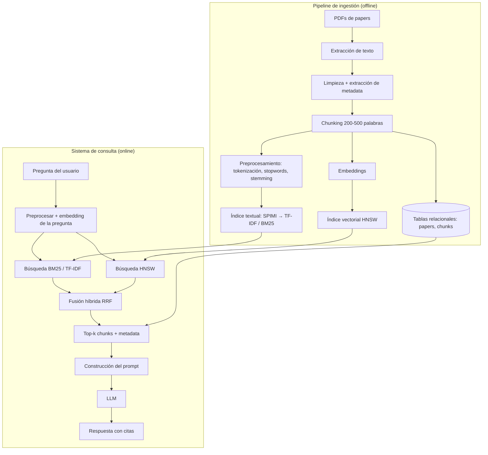

# Proyecto RAG para Documentos Académicos
**Anexo A – Opción A (Parte 5)** · Chatbot que responde preguntas sobre una colección de papers, usando el motor de base de datos propio (basado en PostgreSQL) desarrollado en clase.
 
---
 
## 1. Resumen
 
**RAG (Retrieval-Augmented Generation)** combina dos etapas:
 
1. **Recuperación:** dado una pregunta, el motor de BD encuentra los *chunks* de papers más relevantes.
2. **Generación:** un LLM (Claude, GPT, etc.) recibe la pregunta + los chunks y redacta una respuesta **basada solo en ellos**, citando la fuente.
Ejemplo objetivo:
 
```
Usuario: "¿Cuáles son las ventajas de HNSW sobre IVF?"
Sistema: [Busca en papers] → [Encuentra 3 chunks relevantes] → [Envía a LLM]
LLM:     "Según García et al. (2023), HNSW ofrece mejor precisión..."
```
 
**Qué se aprovecha del motor de clase:** índice de texto (SPIMI + TF-IDF + BM25, Parte 3) e índice vectorial HNSW (Parte 4). **Qué se construye nuevo:** ingestión de PDFs, chunking, extracción de metadata, orquestación de la consulta, integración con el LLM, interfaz y evaluación.
 
---
 
## 2. Arquitectura
 
### 2.1 Vista general
 

 
### 2.2 Módulos
 
| Módulo | Responsabilidad | Tecnología sugerida |
|---|---|---|
| `ingestion` | PDF → texto → metadata → chunks | PyMuPDF, pdfplumber |
| `preprocessing` | Normalizar, tokenizar, stopwords, stemming | NLTK / spaCy |
| `db` (adaptador) | Capa que habla con tu motor Postgres | psycopg |
| `indexing` | Construir SPIMI/TF-IDF/BM25 y HNSW | Tu motor |
| `embeddings` | Texto → vectores | sentence-transformers |
| `retrieval` | Búsqueda textual, vectorial e híbrida | Tu motor + Python |
| `generation` | Prompt + llamada al LLM + citas | anthropic / openai |
| `api` | Endpoint REST | FastAPI |
| `ui` | Interfaz del chatbot | Streamlit o Gradio |
| `evaluation` | Métricas de recuperación y de respuesta | pytest, pandas |
 
### 2.3 Decisión clave: una capa de adaptación al motor
 
Como el motor de clase puede tener su propia sintaxis o API, **aísla todo en una clase `Engine`**. Así, si algo cambia, solo tocas un archivo:
 
```python
# src/db/engine.py  (interfaz que el resto del proyecto usa)
class Engine:
    def insert_paper(self, meta: dict) -> int: ...
    def insert_chunks(self, paper_id: int, chunks: list[dict]) -> list[int]: ...
    def build_text_index(self, method: str = "spimi") -> None: ...
    def build_vector_index(self, m: int = 16, ef_construction: int = 200) -> None: ...
    def search_text(self, query: str, k: int = 10, scoring: str = "bm25") -> list[tuple[int, float]]: ...
    def search_vector(self, query_vec: list[float], k: int = 10, ef_search: int = 50) -> list[tuple[int, float]]: ...
    def get_chunks(self, chunk_ids: list[int]) -> list[dict]: ...
```
 
> **Pendiente de tu parte:** ajusta esta interfaz a la API real de tu motor (¿SQL extendido? ¿funciones Python? ¿comandos propios?). Si me compartes un ejemplo de cómo creas un índice y haces una consulta, adapto el código.
 
---
 
## 3. Modelo de datos (tablas relacionales)
 
```sql
CREATE TABLE papers (
    paper_id    SERIAL PRIMARY KEY,
    title       TEXT NOT NULL,
    authors     TEXT[],           -- o TEXT si tu motor no soporta arrays
    year        INT,
    abstract    TEXT,
    language    VARCHAR(5),       -- 'en', 'es'
    source_file TEXT UNIQUE,      -- nombre del PDF (evita duplicados)
    n_pages     INT,
    created_at  TIMESTAMP DEFAULT now()
);
 
CREATE TABLE chunks (
    chunk_id    SERIAL PRIMARY KEY,
    paper_id    INT REFERENCES papers(paper_id) ON DELETE CASCADE,
    chunk_idx   INT NOT NULL,     -- posición dentro del paper
    page_start  INT,
    page_end    INT,
    section     TEXT,             -- "Introduction", "Results", ...
    content     TEXT NOT NULL,
    n_words     INT,
    embedding   FLOAT8[]          -- o tipo vector de tu motor
);
 
-- Estructuras del índice invertido (si tu motor las expone como tablas)
CREATE TABLE vocabulary (term TEXT PRIMARY KEY, df INT, term_id SERIAL);
CREATE TABLE postings   (term_id INT, chunk_id INT, tf INT, PRIMARY KEY (term_id, chunk_id));
CREATE TABLE chunk_stats(chunk_id INT PRIMARY KEY, doc_len INT);  -- para BM25 (longitud)
 
-- Registro de conversaciones (opcional, útil para la demo y la evaluación)
CREATE TABLE chat_log (
    id SERIAL PRIMARY KEY, question TEXT, answer TEXT,
    retrieved_chunk_ids INT[], latency_ms INT, created_at TIMESTAMP DEFAULT now()
);
```
 
**Por qué el índice se construye sobre `chunks` y no sobre `papers`:** el LLM necesita fragmentos precisos y cortos; indexar documentos completos diluye la relevancia.
 
---
 
## 4. Pipeline de ingestión
 
### 4.1 Extracción de texto del PDF
- **PyMuPDF (`fitz`)**: rápido y bueno para la mayoría de papers. Úsalo por defecto.
- **pdfplumber**: más lento, útil si hay tablas.
- Papers escaneados (sin texto): requeriría OCR (`pytesseract`); evítalo seleccionando papers con texto nativo.
Problemas típicos que **debes limpiar**:
- Guiones de fin de línea (`recupe-\nración` → `recuperación`).
- Encabezados/pies de página repetidos y números de página.
- Papers a dos columnas que mezclan el orden (PyMuPDF con `sort=True` ayuda).
- Sección de *References*: conviene **eliminarla** del indexado (genera ruido).
### 4.2 Metadata (autor, año, título, abstract)
Opciones, de más simple a más robusta:
1. **Metadatos del PDF** (`doc.metadata`): a menudo vacíos o incorrectos.
2. **Heurísticas:** título = texto de mayor tamaño de fuente en la página 1; abstract = texto entre "Abstract" y "Introduction"; año = regex `(19|20)\d{2}`.
3. **Manual/CSV:** para ~20-50 papers, un `metadata.csv` revisado a mano es lo más fiable y totalmente válido para el proyecto.
4. **Opcional:** usar el LLM para extraer el JSON de metadata de la primera página.
**Recomendación:** heurísticas + verificación manual en un CSV.
 
### 4.3 Chunking (200–500 palabras)
- Objetivo: **~300 palabras por chunk** con **solapamiento de 40–60 palabras** (10–20 %), para no cortar ideas por la mitad.
- Respeta límites de oración y de párrafo; evita cortar a mitad de frase.
- Guarda `page_start/page_end` y `section` para citar con precisión.
- Prefija opcionalmente cada chunk (solo para el embedding) con `"{título} — {sección}: "`; mejora la recuperación.
```python
def chunk_text(sentences, target=300, max_words=500, overlap=50):
    chunks, cur, n = [], [], 0
    for s in sentences:
        w = len(s.split())
        if n + w > max_words and cur:
            chunks.append(" ".join(cur))
            # solapamiento: conservar últimas oraciones hasta ~overlap palabras
            tail, m = [], 0
            for t in reversed(cur):
                m += len(t.split()); tail.insert(0, t)
                if m >= overlap: break
            cur, n = tail, sum(len(x.split()) for x in tail)
        cur.append(s); n += w
        if n >= target and w > 0 and s.endswith((".", "?", "!")):
            chunks.append(" ".join(cur)); cur, n = [], 0
    if cur: chunks.append(" ".join(cur))
    return chunks
```
 
---
 
## 5. Indexación (parte central y sugerencias)
 
Ya tienes **SPIMI, TF-IDF, BM25 y HNSW**. Así encajan y qué mejorar.
 
### 5.1 Preprocesamiento (afecta la calidad más que el algoritmo)
- Minúsculas, quitar acentos *solo para el índice* (conserva el texto original en `content`).
- Tokenización con regex que preserve términos técnicos (`HNSW`, `k-NN`, `BM25`, `word2vec`).
- **Stopwords** según idioma del paper (EN/ES).
- **Stemming/lematización:** Snowball (NLTK) para EN y ES.
- **Importante:** aplica **exactamente el mismo pipeline** a la pregunta del usuario.
> **Detalle de idioma:** si los papers están en inglés pero el usuario pregunta en español, el índice textual (léxico) fallará con términos en español. Soluciones: (a) usar un modelo de embeddings **multilingüe** para la ruta vectorial (recomendado), (b) pedir al LLM que reescriba la pregunta al inglés antes de buscar (*query translation*), o (c) restringir la colección a un solo idioma.
 
### 5.2 SPIMI (construcción del índice)
- Procesa chunks en **bloques** que caben en memoria, escribe cada bloque a disco con términos ordenados y luego hace un **merge** de bloques.
- Sugerencias: tamaño de bloque configurable (p. ej. 50 MB), *postings* ordenados por `chunk_id`, compresión de gaps (delta + varint) si quieres impresionar, y **guardar `df`, `doc_len` y `avgdl` durante la construcción** para no recalcularlos en consulta.
- Tras el merge, almacena en Postgres `vocabulary`, `postings`, `chunk_stats`.
### 5.3 TF-IDF vs BM25
| | TF-IDF | BM25 |
|---|---|---|
| Normalización por longitud | No (o coseno) | Sí (parámetro `b`) |
| Saturación de TF | No | Sí (parámetro `k1`) |
| Uso recomendado | Baseline | **Ranking textual principal** |
 
BM25: 
`score(q,d) = Σ IDF(t) · ( tf·(k1+1) ) / ( tf + k1·(1 − b + b·|d|/avgdl) )`, 
con `IDF(t) = ln( (N − df + 0.5)/(df + 0.5) + 1 )`. Valores iniciales: **k1 = 1.2–1.5, b = 0.75**; afínalos con tu conjunto de evaluación.
 
Optimizaciones de consulta (por si el motor es lento):
- Recorre solo las *posting lists* de los términos de la pregunta (nunca todos los chunks).
- Ordena términos por IDF descendente y aplica **early termination** (MaxScore/WAND) si hay tiempo.
- Usa un **heap de tamaño k** en lugar de ordenar todos los resultados.
- Carga `vocabulary` y `chunk_stats` en memoria al arrancar.
- Cachea resultados de consultas repetidas (`functools.lru_cache`).
### 5.4 HNSW (índice vectorial)
> Nota conceptual: **HNSW no es un índice textual**; indexa **vectores** (embeddings). Complementa a BM25 con búsqueda *semántica*.
 
- **Modelo de embeddings (opciones):**
  - `intfloat/multilingual-e5-base` o `BAAI/bge-m3` → multilingüe, muy buenos (recomendados).
  - `sentence-transformers/all-MiniLM-L6-v2` → ligero y rápido (384 dim), solo inglés.
- Con modelos E5 recuerda los prefijos `"query: "` y `"passage: "`.
- **Normaliza los vectores** (L2) y usa distancia coseno/producto interno.
- Parámetros HNSW de partida: `M = 16`, `ef_construction = 200`, `ef_search = 50–100` (sube `ef_search` para más *recall* a costa de latencia).
- Genera embeddings **en lotes** (batch 32–64) y guárdalos en disco; no los recalcules.
### 5.5 Búsqueda híbrida (muy recomendable)
BM25 acierta con términos exactos (`HNSW`, nombres de autores); los vectores captan significado. Combínalos con **Reciprocal Rank Fusion (RRF)**, que no requiere normalizar puntajes:
 
```python
def rrf(rankings: list[list[int]], k: int = 60, top: int = 5):
    scores = {}
    for ranking in rankings:
        for rank, cid in enumerate(ranking, start=1):
            scores[cid] = scores.get(cid, 0.0) + 1.0 / (k + rank)
    return sorted(scores, key=scores.get, reverse=True)[:top]
```
 
### 5.6 Mejoras opcionales
- **Reranking** con un cross-encoder (`cross-encoder/ms-marco-MiniLM-L-6-v2`) sobre los 20 mejores → quedarse con 3–5.
- **Filtros por metadata** (año, autor) antes de buscar: "papers de 2022 en adelante".
- **Deduplicar** chunks casi idénticos y limitar máx. 2 chunks por paper para dar diversidad.
- **Baselines de comparación** (útiles para el informe): `tsvector`+GIN de Postgres para texto, `pgvector` o `faiss` para HNSW. Compara latencia y calidad contra tu motor.
---
 
## 6. Sistema de consulta y generación
 
### 6.1 Flujo
1. Recibir pregunta → detectar idioma (opcional).
2. Preprocesar; calcular embedding.
3. `search_text` (BM25) y `search_vector` (HNSW), k=10–20 cada uno.
4. Fusionar con RRF → top **3–5 chunks**.
5. Recuperar `content` + metadata (autor, año, título, páginas).
6. Construir prompt, llamar al LLM.
7. Devolver respuesta + lista de fuentes.
### 6.2 Plantilla de prompt
 
```text
SISTEMA:
Eres un asistente de investigación. Responde la pregunta usando ÚNICAMENTE
los fragmentos de contexto. Cita cada afirmación con el formato (Autor, Año).
Si el contexto no contiene la respuesta, di claramente que no hay evidencia
suficiente en los documentos. No inventes referencias.
 
CONTEXTO:
[1] García et al. (2023) — "Título del paper", pp. 4-5
{texto del chunk 1}
 
[2] ...
 
PREGUNTA: {pregunta}
```
 
Buenas prácticas:
- `temperature` baja (0–0.2) para respuestas fieles.
- Pide al LLM que responda en el idioma de la pregunta.
- Controla el tamaño: 5 chunks × ~400 palabras ≈ 3 000 tokens, cómodo para cualquier LLM actual.
- Registra en `chat_log` los chunks usados (trazabilidad).
- Mantén la API key en variables de entorno, **nunca en el código ni en el repositorio**.
### 6.3 Conversación multi-turno (opcional)
Para preguntas de seguimiento ("¿y en qué casos falla?"), reescribe la pregunta usando el historial (*query rewriting*) antes de la recuperación.
 
---
 
## 7. API e interfaz
 
**FastAPI** (`POST /ask`):
 
```json
// request
{ "question": "¿Cuáles son las ventajas de HNSW sobre IVF?", "top_k": 5, "mode": "hybrid" }
// response
{
  "answer": "Según García et al. (2023), ...",
  "sources": [
    {"chunk_id": 120, "title": "...", "authors": "García et al.", "year": 2023, "pages": "4-5", "score": 0.0312}
  ],
  "latency_ms": {"retrieval": 85, "generation": 1400}
}
```
 
Otros endpoints: `POST /ingest` (subir PDF), `GET /papers`, `GET /health`.
 
**UI:** Streamlit o Gradio con caja de chat, selector de modo de búsqueda (`bm25 | tfidf | vector | hybrid`) y panel desplegable con los chunks recuperados. El selector de modo es muy útil para **demostrar** el aporte de cada índice.
 
---
 
## 8. Evaluación (lo que suele diferenciar un buen informe)
 
### 8.1 Conjunto de prueba
Crea **20–30 preguntas** sobre tus papers, cada una con el/los chunks o papers que contienen la respuesta (*ground truth*). Mezcla preguntas léxicas ("¿Qué es M en HNSW?") y semánticas ("¿Por qué los grafos escalan mejor?").
 
### 8.2 Métricas
 
| Capa | Métrica | Qué mide |
|---|---|---|
| Recuperación | Recall@k, Precision@k | ¿Está el chunk correcto entre los k? |
| Recuperación | MRR, nDCG@k | Calidad del orden |
| Índices | Latencia p50/p95, tiempo de construcción, tamaño en disco | Eficiencia |
| HNSW | Recall vs. búsqueda exacta (fuerza bruta) | Pérdida por aproximación |
| Generación | Fidelidad (¿se apoya en el contexto?), relevancia, citas correctas | Calidad de la respuesta |
 
### 8.3 Experimentos sugeridos para el informe
1. TF-IDF vs. BM25 vs. HNSW vs. híbrido (tabla de Recall@5, MRR, latencia).
2. Efecto del tamaño de chunk (200 / 300 / 500) y del solapamiento.
3. Efecto de `ef_search` y `M` sobre recall/latencia.
4. Tu motor vs. baseline (`tsvector`/`pgvector`) en tiempo de consulta.
5. Con y sin reranking.
---
 
## 9. Estructura del repositorio
 
```
rag-papers/
├── README.md
├── requirements.txt
├── .env.example
├── data/
│   ├── pdfs/                  # papers originales
│   ├── metadata.csv           # metadata verificada a mano
│   └── eval/questions.jsonl   # preguntas + ground truth
├── src/
│   ├── config.py
│   ├── db/            engine.py, schema.sql
│   ├── ingestion/     pdf_reader.py, cleaner.py, metadata.py, chunker.py
│   ├── preprocessing/ text_pipeline.py
│   ├── indexing/      build_text_index.py, build_vector_index.py
│   ├── embeddings/    encoder.py
│   ├── retrieval/     text_search.py, vector_search.py, hybrid.py
│   ├── generation/    prompt.py, llm_client.py
│   ├── api/           main.py
│   └── ui/            app.py
├── scripts/           ingest_all.py, build_indexes.py, run_eval.py
├── tests/
└── docs/              arquitectura.md, informe/
```
 
---
 
## 10. Requerimientos de software y entorno
 
- **Python** 3.10 o superior.
- **PostgreSQL** (la versión que usa tu motor de clase) con el motor ya instalado/desplegado.
- **Hardware:** CPU es suficiente para ~50–200 papers; GPU solo acelera los embeddings (opcional). ≥ 8 GB de RAM recomendados.
- **Acceso a un LLM:** API key de Anthropic (Claude) u OpenAI, **o** un modelo local vía Ollama si quieres evitar costos.
- **Colección de papers:** 20–100 PDFs con texto nativo (idealmente sobre temas de BD/IR, p. ej. HNSW, IVF, BM25, para que el ejemplo del enunciado tenga sentido).
### 10.1 `requirements.txt`
 
```text
# --- Base de datos ---
psycopg[binary]>=3.1
SQLAlchemy>=2.0
 
# --- Procesamiento de PDFs ---
PyMuPDF>=1.23
pdfplumber>=0.10
 
# --- NLP / texto ---
nltk>=3.8
langdetect>=1.0.9
scikit-learn>=1.3      # baseline TF-IDF y utilidades de evaluación
 
# --- Embeddings y vectores ---
sentence-transformers>=2.6
torch>=2.1
numpy>=1.26
 
# --- LLM ---
anthropic>=0.30
openai>=1.30           # opcional, si usas GPT
 
# --- API e interfaz ---
fastapi>=0.110
uvicorn[standard]>=0.27
pydantic>=2.5
streamlit>=1.32        # o gradio>=4.20
 
# --- Utilidades ---
python-dotenv>=1.0
pandas>=2.1
tqdm>=4.66
requests>=2.31
 
# --- Pruebas y baselines (opcionales) ---
pytest>=8.0
rank-bm25>=0.2.2       # para validar tu implementación de BM25
faiss-cpu>=1.7.4       # baseline para comparar tu HNSW
```
 
### 10.2 Variables de entorno (`.env.example`)
 
```bash
DB_HOST=localhost
DB_PORT=5432
DB_NAME=ragdb
DB_USER=postgres
DB_PASSWORD=cambia_esto
 
ANTHROPIC_API_KEY=
# OPENAI_API_KEY=
 
EMBEDDING_MODEL=intfloat/multilingual-e5-base
LLM_MODEL=              # id del modelo según tu proveedor
TOP_K=5
CHUNK_TARGET_WORDS=300
CHUNK_OVERLAP_WORDS=50
```
 
### 10.3 Puesta en marcha
 
```bash
python -m venv .venv && source .venv/bin/activate   # Windows: .venv\Scripts\activate
pip install -r requirements.txt
python -c "import nltk; nltk.download('stopwords'); nltk.download('punkt')"
cp .env.example .env                                # completar claves
 
psql -f src/db/schema.sql                           # crear tablas
python scripts/ingest_all.py --pdfs data/pdfs --meta data/metadata.csv
python scripts/build_indexes.py --text spimi --vector hnsw
uvicorn src.api.main:app --reload                   # API
streamlit run src/ui/app.py                         # interfaz
python scripts/run_eval.py                          # evaluación
```
 
---
 
## 11. Plan de trabajo sugerido
 
| Fase | Tareas | Entregable |
|---|---|---|
| 1. Preparación | Elegir 20–50 papers, `metadata.csv`, esquema SQL, adaptador `Engine` | BD vacía lista + corpus |
| 2. Ingestión | Extraer texto, limpiar, chunking, cargar tablas | Tablas `papers` y `chunks` pobladas |
| 3. Indexación | Preprocesamiento, SPIMI → BM25/TF-IDF, embeddings, HNSW | Índices construidos y probados |
| 4. Recuperación | Búsqueda textual, vectorial e híbrida (RRF) | Módulo `retrieval` con pruebas |
| 5. Generación | Prompt, cliente LLM, citas | Respuestas con fuentes |
| 6. Interfaz | API FastAPI + UI Streamlit | Demo funcional |
| 7. Evaluación | Conjunto de preguntas, métricas, experimentos | Tablas y gráficos |
| 8. Informe | Arquitectura, resultados, limitaciones, conclusiones | Documento final + demo |
 
---
 
## 12. Riesgos y limitaciones esperables
 
| Riesgo | Mitigación |
|---|---|
| Consultas lentas en el motor de clase | Cachear vocabulario en memoria, heap top-k, limitar *postings*, medir y reportar con honestidad; comparar con baseline |
| Mala extracción de PDFs (columnas, ruido) | Revisión manual de una muestra; quitar *References*; probar PyMuPDF con `sort=True` |
| Pregunta en español vs. papers en inglés | Embeddings multilingües y/o traducción de la consulta |
| Alucinaciones del LLM | Prompt restrictivo, temperatura baja, exigir citas, mostrar chunks fuente |
| Metadata incorrecta → citas erróneas | Verificar `metadata.csv` manualmente |
| Costo/límites de la API del LLM | Cachear respuestas, limitar `top_k`, o usar modelo local |
 
---
 
## 13. Checklist final de entrega
 
- [ ] Esquema de BD y script de creación
- [ ] Pipeline de ingestión reproducible (`ingest_all.py`)
- [ ] Índices: SPIMI + TF-IDF + BM25 y HNSW construidos
- [ ] Búsqueda híbrida con RRF
- [ ] Integración con LLM y respuestas con citas `(Autor, Año)`
- [ ] API y/o interfaz de chat funcionando
- [ ] `requirements.txt` y `.env.example`
- [ ] Conjunto de evaluación + resultados comparativos
- [ ] Diagrama de arquitectura y explicación de limitaciones
- [ ] README con instrucciones de ejecución
- [ ] Ninguna clave secreta en el repositorio
---
 
## 14. Información que me ayudaría a afinar este documento
 
 