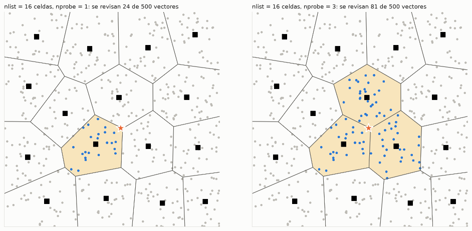
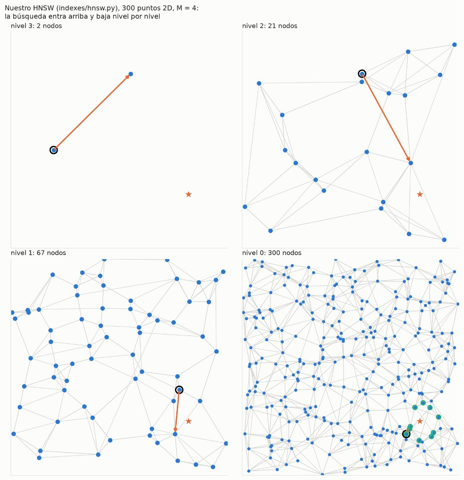

# Índices vectoriales: IVF y HNSW

Parte 4 (§2.4.2). Buscan los k vectores TF-IDF más parecidos a una consulta sin compararla con
toda la colección. Los vectores salen de `multimedia/features.py` (ver
[`multimedia/README.md`](../multimedia/README.md)), son de dimensión K = 1024.

> Tiempos, recall, espacio y recomendaciones con 1k a 20k objetos y contra Faiss y hnswlib:
> [`benchmark/multimedia/README.md`](../benchmark/multimedia/README.md)

| Archivo | Qué es |
|---|---|
| `metricas.py` | euclidiana, producto punto, coseno y la búsqueda lineal exacta (`knn_exacto`) |
| `ivf.py` | Inverted File Index: K-Means parte el espacio en celdas |
| `hnsw.py` | Hierarchical Navigable Small World: grafo de vecinos por niveles |
| `../storage/vector_index.py` | lo que conecta los dos índices con las tablas del motor |

Los dos tienen la misma interfaz y se guardan en un solo `.npz`:

```python
from indexes.ivf import IVF
from indexes.hnsw import HNSW

ivf = IVF(nlist=100, metrica="coseno").entrenar(X).agregar(X)
ids, dist = ivf.buscar(q, k=10, nprobe=10)

hnsw = HNSW(M=16, ef_construction=100, metrica="coseno").agregar(X)
ids, dist = hnsw.buscar(q, k=10, ef_search=50)

hnsw.guardar("portadas.npz"); hnsw = HNSW.cargar("portadas.npz")
```

`buscar` devuelve `(ids, distancias)` del más al menos parecido. `candidatos` dice cuántos vectores
comparó la última búsqueda (con lineal serían todos).

## Métricas (`metricas.py`)

| Métrica | Similitud | Distancia que usan los índices | Alias en SQL |
|---|---|---|---|
| Euclidiana | — | ‖q − x‖ | `euclidean`, `l2` |
| Producto punto | q · x | −q · x | `dot`, `ip`, `inner_product` |
| Coseno | q · x / (‖q‖ ‖x‖) | 1 − coseno | `cosine`, `cos` |

- Todas se usan como distancia (menor = más parecido), así IVF y HNSW ordenan igual con cualquiera
- `get_metrica("cosine")` acepta los nombres en español o los alias del SQL
- Calculan una consulta contra toda una matriz en una sola multiplicación:
  ‖q − x‖² = ‖q‖² + ‖x‖² − 2 q·x. La euclidiana va en float64, en float32 la distancia de un vector
  a sí mismo daba 0.002
- Con vectores normalizados (‖x‖ = 1) las tres dan el **mismo ranking**: ‖q − x‖² = 2 − 2 cos y
  q · x = cos. Por eso el benchmark compara euclidiana y coseno sin normalizar
- `knn_exacto(q, X, k, metrica)` es la búsqueda lineal: la respuesta exacta para medir el recall

## IVF (`ivf.py`)

*Inverted File Index*. La idea es no comparar la consulta con todo: K-Means parte el espacio en celdas
(como un mapa de regiones) y cada vector se guarda en la lista de su celda. Al buscar solo se abren las
celdas más cercanas a la consulta. En la imagen, con nprobe = 1 se revisan 24 de 500 vectores y con
nprobe = 3 se revisan 81



```
entrenar:  K-Means sobre los vectores ─► nlist centroides (celdas)
agregar:   cada vector va a la lista de su centroide más cercano
buscar:    q ─► distancia a los nlist centroides ─► abrir las nprobe celdas más cercanas
              ─► comparar q solo con los vectores de esas listas ─► top k
```

- **nlist** es el número de celdas, no cuántos vectores tiene cada una. Con N = 10 000 y nlist = 100
  cada celda tiene ~100 en promedio
- **nprobe** es cuántas celdas se abren por consulta: se revisa ~nprobe / nlist de la base
  (nprobe = 10 y nlist = 100 → 10 %, más los 100 centroides)
- Es aproximado: si el vecino real cae en una celda vecina que no se abre, se pierde. Subir nprobe
  sube el recall y el tiempo
- La partición la hace `KMeans` de sklearn (k-means++, `n_init=1`), las listas y la búsqueda son propias
- Con coseno se normaliza antes de entrenar (K-Means esférico): agrupa por dirección, que es lo que
  mide el coseno, y no por tamaño
- La celda se asigna con la misma métrica del índice, así un vector queda en la celda que se abriría
  si él fuera la consulta
- Cada celda guarda dos arreglos paralelos: vectores (`listas_vec`) e ids (`listas_ids`)
- En el benchmark se usa nlist = √N; en el motor nlist = 100 (o N si la tabla es más chica)

Con 10k TF-IDF (nlist = 100, coseno, 200 consultas fuera de la base):

| nprobe | 1 | 5 | 10 | 20 | 50 |
|---|---|---|---|---|---|
| recall@10 portadas | .48 | .85 | .94 | .98 | .995 |
| recall@10 audio | .51 | .86 | .94 | .98 | .997 |
| ms portadas (lineal 8.0) | 0.2 | 0.9 | 1.8 | 3.0 | 6.1 |

## HNSW (`hnsw.py`)

Malkov y Yashunin (2020). Es el índice vectorial más usado (pgvector, Faiss, Pinecone...). Cada vector
es un nodo de un grafo conectado a sus vecinos más cercanos, y buscar es caminar por el grafo
acercándose cada vez más a la consulta. Junta dos ideas:
- **NSW**: un grafo donde cada vector está conectado a sus vecinos cercanos y a algunos lejanos, así
  se llega de cualquier nodo a cualquier otro en pocos saltos con una búsqueda voraz
- **Skip list**: varios niveles, arriba pocos nodos con saltos largos y abajo todos

```
nivel 2:  A ──────────────────────── F                  pocos nodos, saltos largos
nivel 1:  A ─────── C ───────── E ── F
nivel 0:  A ── B ── C ── D ── E ── F ── G ── H          todos los nodos
```



En la imagen: arriba hay pocos nodos y la búsqueda da saltos largos (línea roja), y en cada nivel de abajo
hay más nodos y los pasos son más cortos, hasta llegar a la consulta en el nivel 0

- **Nivel de cada nodo:** al azar, `l = ⌊−ln(U) · mL⌋` con `mL = 1 / ln M`. Así P(l ≥ L) = M^(−L):
  con 20 000 nodos y M = 16 quedan ~1 250 en el nivel 1, ~80 en el 2 y ~5 en el 3
- **Buscar:**
  1. Empezar en el punto de entrada (el nodo de nivel más alto)
  2. En cada nivel de arriba hasta el 1, búsqueda voraz con ef = 1: el más cercano es la entrada del nivel de abajo
  3. En el nivel 0, búsqueda con ef = `ef_search` candidatos y devolver los k mejores
- **Insertar:** se busca igual, y en cada nivel desde el del nodo hasta el 0 se conecta con M vecinos
  de los `ef_construction` candidatos. En el nivel 0 se permiten 2M. Si un vecino se pasa del máximo,
  se poda su lista
- **Heurística de vecinos** (algoritmo 4 del paper): un candidato entra solo si está más cerca del
  nodo nuevo que de los vecinos ya elegidos. Así los vecinos apuntan en direcciones distintas y el grafo
  no se queda encerrado en un grupo. Si sobran lugares se completan con los descartados.
  `heuristica=False` usa los M más cercanos
- `_buscar_nivel` usa dos heaps: `cand` (min-heap de por explorar, sale el más cercano) y `mejores`
  (max-heap con los ef mejores, arriba el peor de ellos). Para cuando el candidato más cercano que queda
  está más lejos que el peor de `mejores`: nada de lo que falta puede mejorar
- `visto` evita calcular dos veces la distancia al mismo nodo, y las distancias a todos los vecinos
  nuevos se calculan juntas
- Construir es lo lento (Python puro): ~3 min para 20 000 portadas

Con 10k TF-IDF (M = 16, ef_construction = 100, coseno, 200 consultas fuera de la base):

| ef_search | 10 | 20 | 40 | 80 | 160 |
|---|---|---|---|---|---|
| recall@10 portadas | .89 | .95 | .98 | .993 | 1.0 |
| recall@10 audio | .88 | .96 | .985 | .998 | 1.0 |
| ms portadas (lineal 8.0) | 0.5 | 0.8 | 1.2 | 2.0 | 3.5 |

## IVF vs HNSW

| | IVF | HNSW |
|---|---|---|
| Estructura | celdas de K-Means + listas | grafo de vecinos por niveles |
| Construir 20k portadas | ~10 s | ~175 s |
| Consulta (20k) | 2.6 ms, recall .94 | 1.8 ms, recall .98 |
| Crece con N | la consulta crece con N / nlist | casi constante (~log N) |
| Agregar después | barato, pero las celdas no se re-entrenan | caro, cada nodo busca sus vecinos |
| Perilla | `nprobe` | `ef_search` |
| Espacio extra | ~0.7 MB (centroides + ids) | ~4 MB (listas de vecinos) |

## En el motor (`storage/vector_index.py`)

`CREATE INDEX ON tabla (columna) USING IVF|HNSW` sobre una columna `VARCHAR` que guarda rutas de
imágenes o audios crea un `VectorSecondaryIndex`, igual que el R-Tree se cuelga de la tabla:

- Cada ruta se vuelve un vector con `ExtractFeatures` (o el que ya está calculado en la base TF-IDF)
  y el índice guarda `(vector, rid)`
- Los vectores van **normalizados**, así un solo índice sirve para las tres métricas de `WITH METRIC`
  (dan el mismo ranking); la métrica solo cambia el `SIMILARITY_SCORE()`
- `INSERT` agrega el vector al índice y `DELETE` lo marca como borrado
- Se guarda en `<índice>.npz` (vectores y rids) + `<índice>_indice.npz` (la estructura). Al abrir, si
  la tabla cambió con el índice cerrado, se reconstruye
- Parámetros: IVF con nlist = 100 (o N si hay menos filas) y nprobe = 10; HNSW con M = 16, ef_construction = 100 y ef_search = 50

La sintaxis SQL está en el [README principal](../README.md#sql-de-la-parte-4).

## Referencias

- Jégou, H., Douze, M. y Schmid, C. (2011). Product quantization for nearest neighbor search. *IEEE Transactions on Pattern Analysis and Machine Intelligence*, 33(1), 117–128. (IVF)
- Malkov, Y. A. y Yashunin, D. A. (2020). Efficient and robust approximate nearest neighbor search using Hierarchical Navigable Small World graphs. *IEEE Transactions on Pattern Analysis and Machine Intelligence*, 42(4), 824–836. Publicado en línea en 2018, arXiv:1603.09320. (HNSW)
- Malkov, Y., Ponomarenko, A., Logvinov, A. y Krylov, V. (2014). Approximate nearest neighbor algorithm based on navigable small world graphs. *Information Systems*, 45, 61–68. (NSW)
- Pugh, W. (1990). Skip lists: a probabilistic alternative to balanced trees. *Communications of the ACM*, 33(6), 668–676.
- Arthur, D. y Vassilvitskii, S. (2007). k-means++: the advantages of careful seeding. *SODA 2007*, 1027–1035.
