# Multimedia

Parte 4 (§2.4.1): `ExtractFeatures(objeto)` convierte una imagen o un audio en un vector de dimensión K
para buscar contenido parecido. Es la misma idea que en texto, pero aquí no hay palabras: hay píxeles y
muestras de audio. Entonces las palabras se fabrican. De cada imagen o audio se sacan muchos vectores
chiquitos (descriptores locales), se agrupan todos los de la colección con K-Means y cada grupo pasa a ser
una "palabra". Así cada objeto queda como un histograma de cuántas veces aparece cada palabra, igual que
un documento. A esto se le llama *bag of visual words* (o *audio words*)

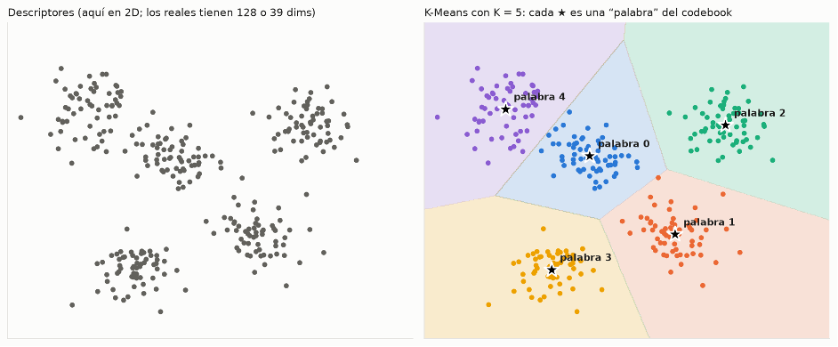

```
archivo ─► descriptores locales ─► palabra más cercana ─► histograma tf ─► × idf ─► vector TF-IDF (K = 1024)
           SIFT (128) / MFCC (39)    codebook K-Means                                  │
                                                                                      ▼
                                                              IVF / HNSW (indexes/) ─► SIMILAR_TO en SQL
```

| Texto (Parte 3) | Multimedia (Parte 4) |
|---|---|
| documento | imagen o audio |
| token (palabra después de stemming) | descriptor local: punto SIFT o ventana MFCC |
| vocabulario | codebook: K centroides de K-Means |
| tf: veces que aparece la palabra | tf: fracción de descriptores que cae en cada centroide |
| idf | igual: `log(N / df)` |
| índice invertido SPIMI | índice vectorial IVF o HNSW |
| `MATCH(...)` | `SIMILAR_TO(...)` |

Todo corre en el entorno `vision` y guarda en `data/features/`, que no se sube al repo.
Los pasos, en orden (todos se pueden cortar y volver a correr, siguen donde se quedaron):

```bash
conda activate vision
python -m multimedia.sift --source covers                 # 1. descriptores de las portadas
python -m multimedia.mfcc                                 # 1. descriptores de los audios
python -m multimedia.codebook --tipo ambos --ks 1024      # 2. codebook con K-Means
python -m multimedia.features --tipo ambos --k 1024       # 3. vectores TF-IDF de toda la colección
```

| Paso | Salida en `data/features/` | Tamaño con la data completa |
|---|---|---|
| SIFT | `sift/<ruta>.npy` + `sift_covers.csv` | 20 005 portadas, ~457 descriptores c/u (9.1 M) |
| MFCC | `mfcc/<track_id>.npy` + `mfcc.csv` | 13 643 audios, ~1 290 ventanas c/u (12.9 M con 10k) |
| Codebook | `codebook/<tipo>_k1024.npz` (`centroides, media, desv`) | 1024 × 128 y 1024 × 39 |
| TF-IDF | `tfidf_<tipo>_k1024.npz` (`ids, tf, idf, vectores`) | 20 005 × 1024 (sift), 10 000 × 1024 (mfcc) |

## 1. Descriptores locales

| | SIFT (imágenes) | MFCC (audio) |
|---|---|---|
| Archivo | `sift.py` | `mfcc.py` |
| Pedazo | punto clave (esquina, borde, textura) | ventana de 93 ms que avanza 23 ms |
| Vectores por objeto | ~457 (máx. 500) | ~1 290 por preview de 30 s |
| Dimensión | 128 | 39 |
| Aguanta | escala, rotación, brillo | volumen |
| No ve | color | melodía |

### SIFT

*Scale-Invariant Feature Transform*. Busca puntos de la imagen que se pueden volver a encontrar aunque
la imagen esté más chica, rotada o más oscura (esquinas, manchas, bordes) y describe la zona alrededor
de cada uno con 128 números. Cada círculo es un punto clave: su tamaño es la escala y la raya su orientación

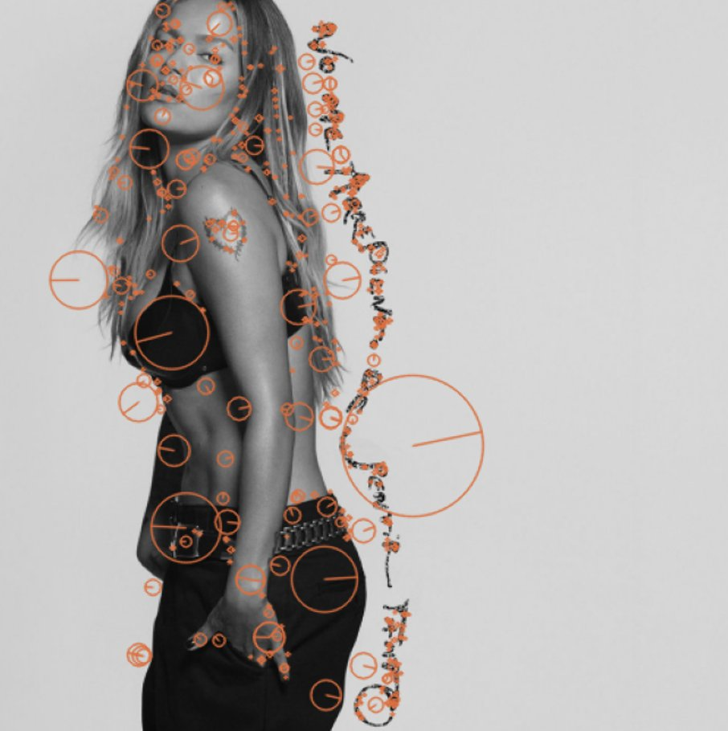

**Cómo encuentra puntos a distintas escalas.** La imagen se desenfoca con gaussianas cada vez más anchas
(σ, kσ, k²σ...), mientras más se desenfoca es como verla más de lejos. Cada vez que σ se duplica la imagen
se reduce a la mitad (una octava) y así se arma una pirámide. Luego se restan imágenes vecinas:
`D = L(kσ) − L(σ)`. Esa resta de gaussianas (DoG) da valores muy altos o muy bajos justo donde hay una
mancha del tamaño de σ

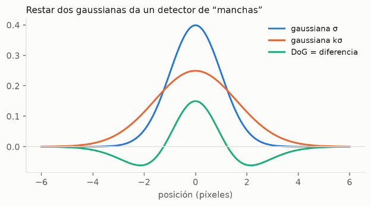
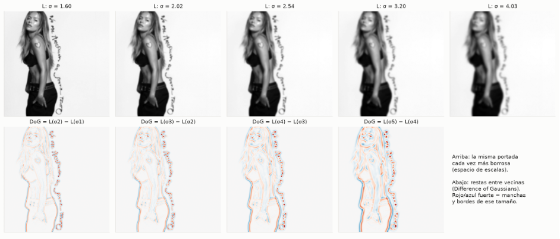

**El descriptor.** Alrededor del punto (ya girado a su orientación) se toma una ventana de 16 × 16, se parte
en 4 × 4 celdas y en cada una se hace un histograma de 8 direcciones del gradiente (hacia dónde cambia el
brillo): 4 × 4 × 8 = 128

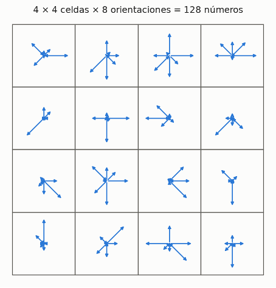

Detalles:
- Detector: busca extremos en la pirámide de diferencias de gaussianas (DoG), cada punto es más
  alto o más bajo que sus 26 vecinos (8 en su escala, 9 arriba, 9 abajo). Eso da la posición y el tamaño
- Se descartan los de poco contraste y se calcula la orientación dominante (histograma de 36 ángulos
  del gradiente), por eso aguanta rotaciones
- Descriptor: ventana de 16 × 16 alrededor del punto, 4 × 4 celdas con un histograma de 8 orientaciones
  cada una = 128 números
- La imagen se pasa a gris y se achica a 512 px de lado (`MAX_SIDE`), más grande es más lento y no da puntos mejores
- Se quedan los 500 puntos de mayor contraste (`N_FEATURES`), el 64 % de las portadas llega a ese tope
- RootSIFT: se normaliza L1 y se saca raíz, así la distancia euclidiana entre descriptores equivale a
  Hellinger, que compara mejor histogramas
- Portadas: las de `data/covers.csv` sin `duplicada_de`. Con `--source all` también artistas e
  integrantes (solo las fotos que aceptó el filtro de caras, para la Parte 5)
- 15 de las 20 005 portadas no tienen ningún punto clave: son de un color plano o texto y fondo de
  colores distintos pero mismo brillo (en gris quedan lisas). Su vector queda en cero. Para esas sirve
  más el histograma de color (abajo, en Extras)

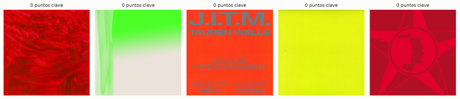
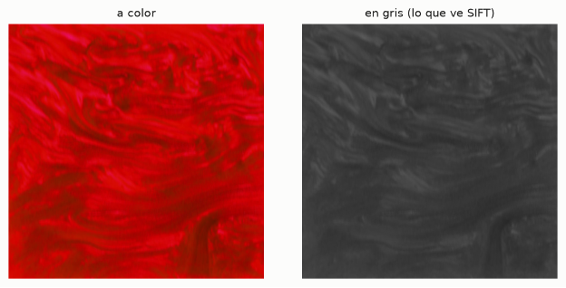

### MFCC

*Mel-Frequency Cepstral Coefficients*, es como SIFT pero para audio. En vez de puntos clave, la canción
se parte en ventanas muy cortas (en 93 ms el sonido casi no cambia) y cada ventana se describe con pocos
números que resumen el timbre, o sea cómo suena: voz, bajo, platillos. Se propuso en 1980 para
reconocimiento de voz y es el descriptor clásico de audio

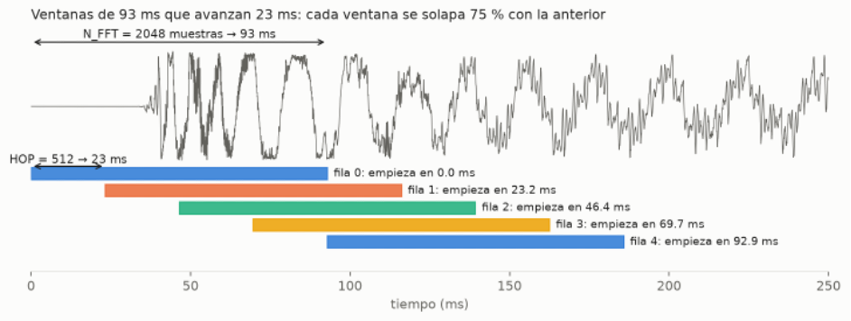

Paso a paso: la onda → espectrograma (FFT por ventana) → espectrograma mel (40 bandas, como escucha el
oído: `mel(f) = 2595 · log10(1 + f / 700)`) → log → DCT, que deja los primeros coeficientes con la forma
general del espectro

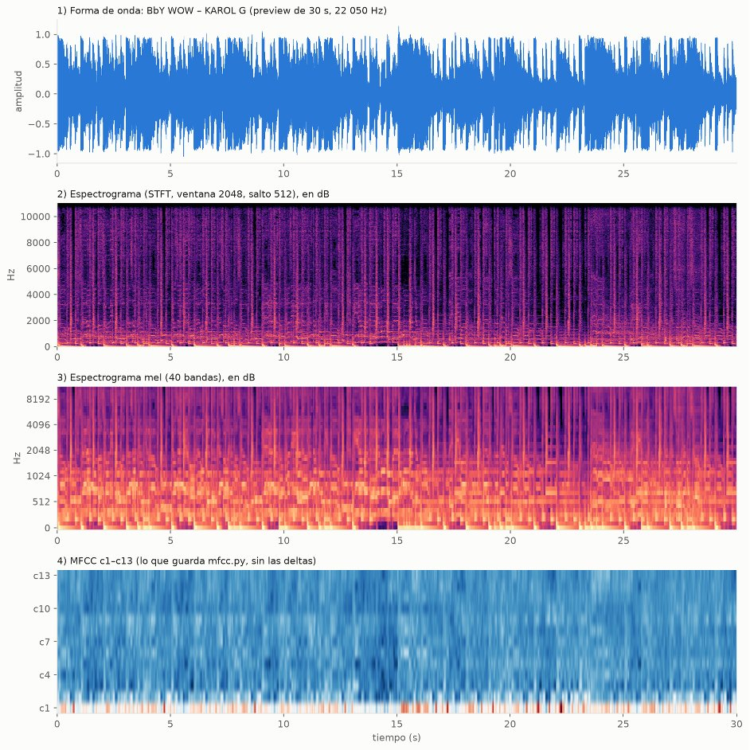

Al final cada canción es una matriz de 39 filas (13 MFCC + 13 Δ + 13 ΔΔ) por ~1 290 ventanas

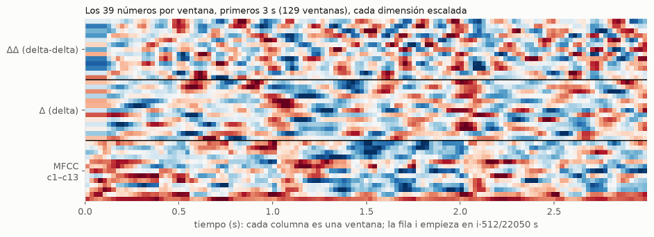

Detalles:
- Audio mono a 22 050 Hz
- Ventana de 2048 muestras (93 ms) con avance de 512 (23 ms, 75 % de solapamiento) y ventana de Hann
- Por ventana: FFT, 40 bandas mel, log y DCT, se guardan los coeficientes 1 a 13
- El coeficiente 0 es el volumen, se descarta para que la misma canción más fuerte o más bajita dé lo mismo
- Se agregan delta y delta-delta (cuánto cambia el timbre entre ventanas): 13 + 13 + 13 = 39
- La fila `i` empieza en el segundo `i * 512 / 22050`, sirve para buscar por fragmentos
  (`extraer_mfcc(path, offset=10, duration=5)`)
- Antes del K-Means se estandariza cada dimensión (z-score), las deltas son mucho más chicas que los coeficientes

## 2. Codebook (K-Means)

Los millones de descriptores se agrupan en K centroides, cada centroide es una "palabra"

- `MiniBatchKMeans` de sklearn, k-means++, `n_init=3`, semilla 0
- Se entrena con una muestra de máximo 50 descriptores por objeto (tope 300 000), con las 10 000 canciones
- MFCC se estandariza antes y la media y la desviación se guardan con los centroides, para estandarizar
  igual las consultas. SIFT no (ya viene con RootSIFT)

### Por qué K = 1024

Se probó K de 64 a 4096 (`codebook-k-finding.ipynb`) con consultas de respuesta conocida: portadas
rotadas, recortadas, oscurecidas o comprimidas y fragmentos de 5 s de audio, con y sin ruido.
recall@10 = la original sale entre las 10 primeras (búsqueda exacta por coseno)

| K (10k) | 512 | 1024 | 2048 | 4096 |
|---|---|---|---|---|
| portada recortada al 70 % | .74 | .81 | .87 | .92 |
| portada jpeg + 200 px | .30 | .45 | .59 | .71 |
| audio fragmento 5 s | .80 | .88 | .94 | .97 |
| audio 5 s + ruido | .54 | .62 | .69 | .73 |
| ms por consulta (sift / mfcc) | 1.1 / 0.8 | 2.0 / 1.6 | 3.8 / 3.4 | 8.1 / 5.9 |

- La inercia baja casi en recta con K (en escala log), no hay un codo claro, así que el método del codo no
  sirve para elegir. Davies-Bouldin también mejora siempre con K

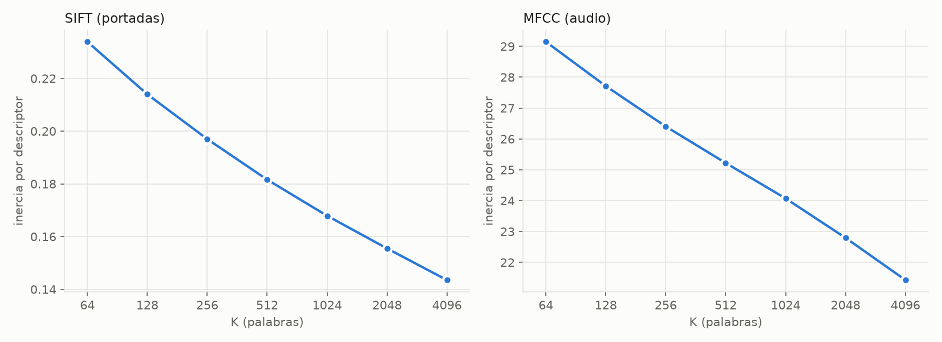
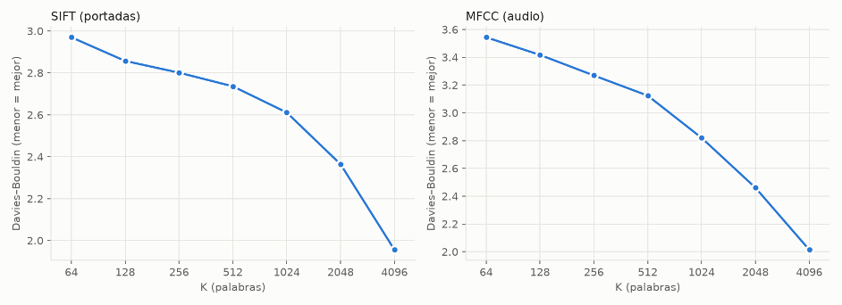

- Lo que decide es el recall de las consultas modificadas contra el tiempo:

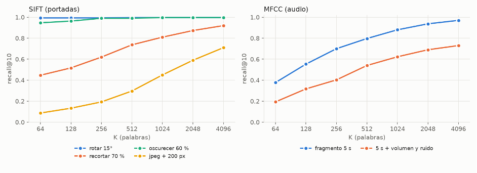

- Más K = palabras más específicas y mejor recall, pero vectores más grandes, consultas más lentas y
  palabras casi vacías (con 1k, en 4096 un tercio de las palabras tiene menos de 5 descriptores)
- 1024 es el punto medio: buen recall sin duplicar el tiempo por consulta. K también es la dimensión
  de los vectores que indexan IVF y HNSW

## 3. TF-IDF (`features.py`)

```
tf(w, d) = n(w, d) / Σ n(w', d)      idf(w) = log(N / df(w))      v_d = tf · idf / ‖tf · idf‖₂
```

- `palabras()`: cada descriptor va a su centroide más cercano (euclidiana, en lotes de 50 000)
- `histograma()`: tf = fracción de descriptores en cada palabra, así no importa cuántos puntos tenga el objeto
- `construir_base()`: tf de toda la colección, idf y vectores normalizados en `tfidf_<tipo>_k1024.npz`
- `ExtractFeatures(path)`: decide SIFT o MFCC por la extensión y usa el mismo codebook e idf de la base,
  así una consulta nueva queda en el mismo espacio. `normalizar=False` deja el vector sin normalizar
  (para comparar euclidiana y coseno en el benchmark)

```python
from multimedia.features import ExtractFeatures
v = ExtractFeatures("data/covers/110599312.jpg")   # np.ndarray (1024,), norma 1
```

Los índices y las métricas están en [`indexes/VECTOR_README.md`](../indexes/VECTOR_README.md) y la
comparación en [`benchmark/multimedia/README.md`](../benchmark/multimedia/README.md)

## Extras

### Histograma de color (`color.py`)
Descriptor global de las portadas, para lo que SIFT no ve. 12 tonos x 4 saturaciones + 2 grises (oscuro y claro) = 50 dimensiones, con raíz como RootSIFT

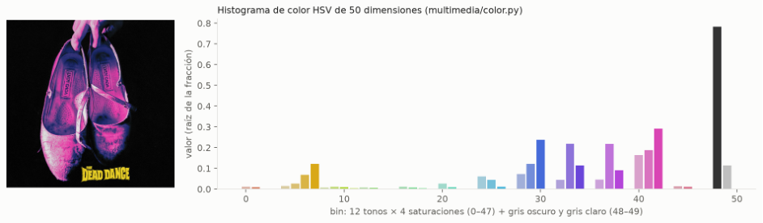

Casi no se mira el brillo: con 3 niveles de brillo por color una portada oscurecida al 60 % encontraba la original en el top 10 el 17 % de las veces, así el 91 %

Probado con 300 portadas modificadas buscando entre las 8 400:

| Cambio | Top 1 | Top 10 |
|---|---|---|
| Rotar 90° / 15° | 100 % / 99 % | 100 % |
| Recortar al 70 % | 86 % | 95 % |
| Oscurecer al 60 % | 84 % | 91 % |
| Aclarar x1.3 | 87 % | 94 % |
| JPEG comprimido + 200 px | 69 % | 87 % |

Solo encuentra colores parecidos, no la misma portada, por eso la idea es sumarlo a SIFT: `a * sim_sift + (1 - a) * sim_color`

### Embeddings de cara (`face_embeddings.py`)
Igual que en el Lab 11: ResNet de dlib vía `face_recognition`, 128 dimensiones, misma persona si la distancia es < 0.6. Usa la caja de la cara que guardó el filtro (`face_box`) así que no vuelve a detectar, y achica a 1000 px porque a resolución completa es ~10 veces más lento

Sale en `faces.npz` con `embedding, path, kind, owner_id, name`. Es un vector por cara, no necesita codebook. Sirve para buscar por artista (Parte 5)
